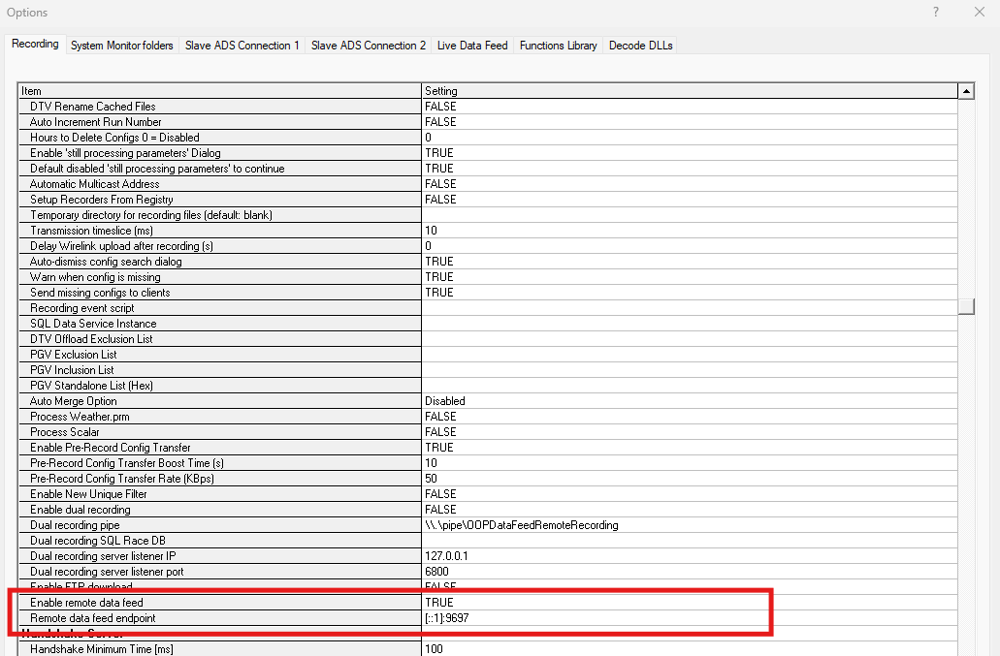

# Bridge Service

## Introduction
The Bridge Service decodes a raw stream of quads from an ATLAS Data Server (ADS), converting the data to engineering 
values then into the Stream Protocol via the Stream API. It includes components to manage sessions, configuration, 
metadata etc. 
All RDA protected data will be filtered out at this point, based on the active team license, so any downstream 
components will only receive data available to the team. 


## Choose your deployment

Bridge Service is the same program in every deployment. What changes is how it is started, and therefore which
configuration file it reads.

| How Bridge Service runs | Configuration file it reads |
|---|---|
| **Launched by ADS** (installed with ADS) | `Documents\McLaren Electronic Systems\ATLAS 9\BridgeService\BridgeServiceConfig.json` |
| **Standalone on Windows** (you run `MA.DataPlatforms.Bridge.Host.exe` yourself) | `Configs\AppConfig.json` next to the exe, or the file you pass with `-c` |
| **Docker** (`atlasplatformdocker/bridge-service-host`) | `/app/Configs/AppConfig.json` in the container, or the file named by the `CONFIG_FILE_PATH` environment variable |

`BridgeServiceConfig.json` and `AppConfig.json` have the same format and accept the same sections, described in the
[Configuration Guide](configuration-guide.md).

=== "Launched by ADS"

    On first launch, ADS copies the default `AppConfig.json` from `<ADS install folder>\BridgeService\Configs\` to
    `Documents\McLaren Electronic Systems\ATLAS 9\BridgeService\BridgeServiceConfig.json`. From then on, ADS always
    starts Bridge Service with that copy.

    - **Edit `BridgeServiceConfig.json`**, not the `AppConfig.json` in the install folder. Once the copy exists, changes
      to the install-folder file have no effect.
    - To start again from the default file (for example after upgrading ADS), delete `BridgeServiceConfig.json`. ADS
      creates a new copy the next time it launches Bridge Service.
    - ADS passes its own feed port to Bridge Service, which overrides `BridgeConfig.FeedPort` in the file.
    - If `EssentialsConfig` and `RdaConfig` paths are left empty, Bridge Service uses the config, PGV and PUL folders
      set in ATLAS 9 for the Windows user running it.

    Bridge service uses the name of the ADS as the DataSource name. This can be configured within the ADS on
    Setup | General | General Network Settings | Name.

=== "Standalone on Windows"

    Run `MA.DataPlatforms.Bridge.Host.exe`. It accepts three optional command-line arguments:

    | Argument | Meaning | Example |
    |---|---|---|
    | `-c` | Configuration file path | `-c "C:\Bridge\MyConfig.json"` |
    | `-l` | Log file path (see [Logging](configuration-guide.md#7-serilog-configuration)) | `-l "C:\Logs\bridge.txt"` |
    | `-p` | Feed port that ADS connects to | `-p 9697` |

    !!! warning "Use an absolute `-c` path, or start from the install folder"
        A relative configuration path is resolved from the folder Bridge Service is started from. If you start it from
        anywhere else, pass an absolute path with `-c`.

    As with ADS, empty `EssentialsConfig` and `RdaConfig` paths fall back to the config, PGV and PUL folders set in
    ATLAS 9 for the Windows user running Bridge Service.

=== "Docker"

    The image runs from `/app` and reads `/app/Configs/AppConfig.json`. Either mount your own file over it, or mount it
    anywhere and set `CONFIG_FILE_PATH` to its absolute path inside the container.

    ```bash
    docker run -p 9697:9697 -p 10011:10011 -v /srv/bridge/AppConfig.json:/app/Configs/AppConfig.json:ro -v /srv/essentials:/essentials:ro atlasplatformdocker/bridge-service-host
    ```

    !!! warning "Settings you must change for Docker"
        - **`EssentialsConfig.CfgDirectoryPaths` and `PgvDirectoryPaths` are required.** There is no ATLAS 9 fallback
          in a container: if either is empty, Bridge Service stops at startup with
          *"DirectoryPaths needs to be specified in EssentialsConfig"*. List the folders as they appear **inside** the
          container. If you use PUL files, set `RdaConfig.PulFilesSearchPaths` the same way.
        - **`StreamApiConfig.BrokerUrl`**: `localhost` refers to the container itself. Point it at your Kafka broker's
          host name.
        - **Ports**: publish the feed port (default `9697`) that ADS connects to, and the Prometheus metrics port
          (`10011` in the default configuration file).

    Any setting can also be overridden with an
    [environment variable](configuration-guide.md#overriding-configuration-with-environment-variables), for example
    `-e StreamApiConfig__BrokerUrl=kafka:9092`.

## Splitting data across Kafka topics or partitions

The data can be split across multiple Kafka topics or partitions. For more information, refer to
[Stream Creation Strategy](../stream_api/reference_docs/configuration/server-config.md/#stream-creation-strategies).
The examples below show only the two relevant sections.

!!! note "Add or update — don't replace the whole file"
    Change these sections in your existing configuration file and leave the other sections in place.

=== "Example with StreamCreationStrategy=2 (Topic based)"

    ```json title="BridgeServiceConfig.json" linenums="1" hl_lines="3"
    {
        "StreamApiConfig": {
            "StreamCreationStrategy": 2,
            "BrokerUrl": "localhost:9094",
            "PartitionMappings": [ {} ],
            "IntegrateSessionManagement": true,
            "IntegrateDataFormatManagement": true,
            "UseRemoteKeyGenerator": false,
            "RemoteKeyGeneratorServiceAddress": "",
            "BatchingResponses": false
        },
        "StreamSelectionConfig": {
            "Auto": true,
            "Mappings": [ {} ]
        }
    }
    ```
=== "Example with StreamCreationStrategy=1 (Partition based)"

    ```json title="BridgeServiceConfig.json" linenums="1" hl_lines="3"
    {
        "StreamApiConfig": {
            "StreamCreationStrategy": 1,
            "BrokerUrl": "localhost:9094",
            "PartitionMappings": [ 
            {
                "Stream": "Stream1",
                "Partition": 1
            },
            {
                "Stream": "Stream2",
                "Partition": 2
            },
            {
                "Stream": "Stream3",
                "Partition": 3
            },
            {
                "Stream": "Stream4",
                "Partition": 4
            },
            {
                "Stream": "Stream5",
                "Partition": 5
            },
            {
                "Stream": "Stream6",
                "Partition": 6
            },
            {
                "Stream": "Stream7",
                "Partition": 7
            },
            {
                "Stream": "Stream8",
                "Partition": 8
            },
            {
                "Stream": "Stream9",
                "Partition": 9
            } ],
            "IntegrateSessionManagement": true,
            "IntegrateDataFormatManagement": true,
            "UseRemoteKeyGenerator": false,
            "RemoteKeyGeneratorServiceAddress": "",
            "BatchingResponses": false
        },
        "StreamSelectionConfig": {
            "Auto": false,
            "Mappings": [  
            {
                "AppName": "ATLAS",
                "Stream": "Stream1"
            },
            {
                "AppName": "FIA",
                "Stream": "Stream2"
            },
            {
                "AppName": "Chassis",
                "Stream": "Stream3"
            },
            {
                "AppName": "Arbitrator",
                "Stream": "Stream4"
            },
            {
                "AppName": "Coordinator",
                "Stream": "Stream5"
            },
            {
                "AppName": "Controller",
                "Stream": "Stream6"
            },
            {
                "AppName": "Dash",
                "Stream": "Stream7"
            },
            {
                "AppName": "BrakeControl",
                "Stream": "Stream8"
            },
            {
                "AppName": "TAG320BIOS",
                "Stream": "Stream9"
            }  ]
        }
    }
    ``` 


!!! info "Logs"
    From Bridge Service 2.1.1, the default configuration file logs to the console window only, so no log file is
    written unless you configure one. See [Logging](configuration-guide.md#7-serilog-configuration).

## Setup

**Prerequisite:**

Kafka broker - The Bridge service needs to be configured to write to a Kafka broker. As you can see in the above example, the config file points to a broker url, which is hosting kafka locally on the same machine as the ADS.

To enable the Bridge Service, set "Enable remote data feed" setting to "True" in ADS | Tools | Options | Recording tab | General


Restart ADS once the setting is applied. 

Once the data is published on Kafka, users can use the Stream API to consume the data. For more information, please refer to the [Stream API Sample code](https://github.com/mat-docs/MA.Streaming.Api.UsageSample)

!!! note
    Currently, ADS will launch the Bridge Service in a separate command prompt for ease of testing/validation and diagnostics.

## UNIX Timestamps

Timestamps from Motion Applied ECUs are relative to midnight local time. To convert the timestamps to UNIX epoch time in UTC, 
the date and the local timezone offset on the machine hosting the bridge service is used. 

!!! warning
    It also applies to File Telemetry Recorders and Multi-Session Offload Recorders in addition to live telemetry. 
    Replaying a raw file on a machine that is incorrectly configured could publish timestamps at the incorrect date and 
    timezone.
