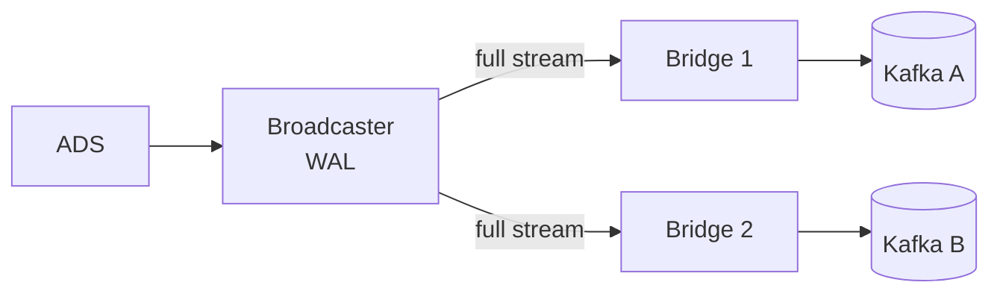
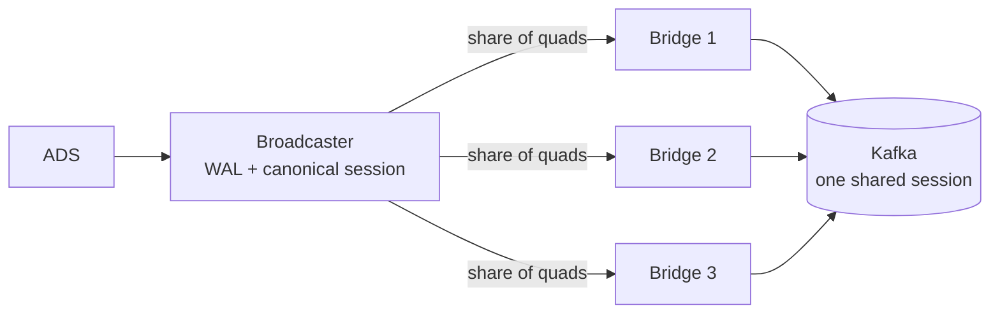
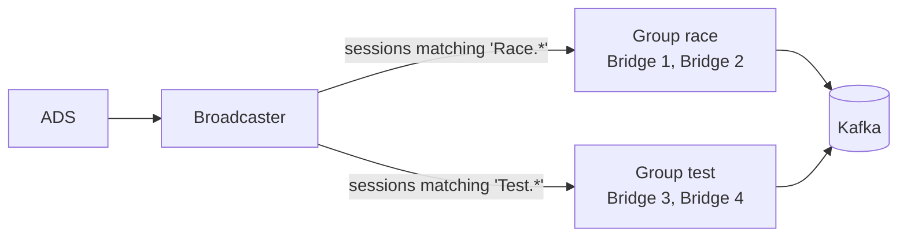
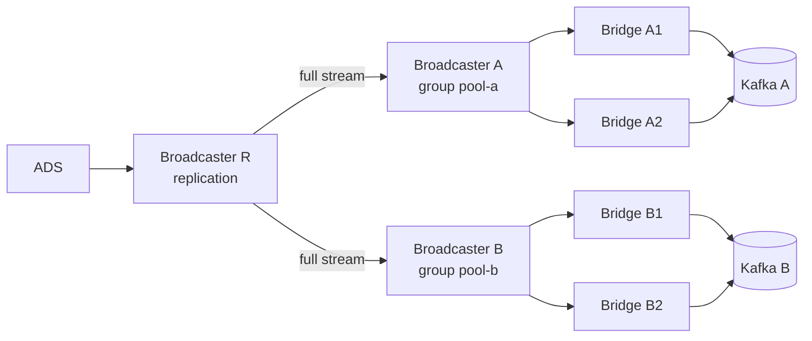

# Replication and Load Balancing

Broadcast Service can feed its downstream Bridges in two different ways. Which one you get is decided by a
single switch, `ConsumerGroups.Enabled`.

| | Replication | Load balancing (consumer groups) |
|---|---|---|
| `ConsumerGroups.Enabled` | `false` (default) | `true` |
| What each Bridge receives | The **whole** stream | A **share** of each session's telemetry |
| Purpose | Redundant copies, one per destination | Spread decoding load across several Bridges |
| Kafka sessions | Each Bridge creates its own session in its own Kafka | All Bridges in a group write into **one** shared session |
| Bridge setting | Normal Bridge configuration | `UseDataFeedSessionKeyAsCanonicalSessionKey: true` |

In both modes ADS connects to Broadcast Service exactly as it would to a Bridge, and Broadcast Service persists
everything to its write-ahead log (WAL) first, so a Bridge that disconnects or falls behind catches up from the log.

!!! note "Pick one mode per Broadcast Service instance"
    When `ConsumerGroups.Enabled` is `true`, **every** Bridge target must belong to a consumer group. You cannot mix
    replicated (ungrouped) Bridges and load-balanced Bridges in the same instance. To combine the two, chain
    instances — see [Replicating to several load-balanced destinations](#replicating-to-several-load-balanced-destinations).

## Set up Broadcast Service

The basic installation (running it, the feed port, the WAL volume) is covered in
[Getting Started](getting-started.md). The rest of this page covers the Bridge and Kafka sides, and the topologies.

Whichever mode you use:

1. Run Broadcast Service and note its `FeedPort` (default `9697`).
2. In ADS, point the remote data feed at the Broadcast Service host and `FeedPort` — the same place you would
   point it at a Bridge.
3. Run each downstream Bridge with its `BridgeConfig.FeedPort` set to the `Port` of its entry in
   `Targets.BridgeConfigs`.
4. Check `broadcast_target_up{target="..."}` on `http://<host>:10010/metrics` reads `1` for every target.

## Replication

Every Bridge target receives every message, each on its own replay cursor. A slow or offline Bridge never affects
the others.



Leave `ConsumerGroups.Enabled` as `false` (or omit the section) and list one entry per Bridge:

```json title="Broadcast Service AppConfig.json" linenums="1"
{
  "BroadcastConfig": {
    "FeedPort": 9697,
    "MetricPort": 10010,
    "Wal": { "Directory": "./wal" },
    "ConsumerGroups": { "Enabled": false },
    "Targets": {
      "BridgeConfigs": [
        { "Name": "site-a-bridge", "Host": "site-a.internal", "Port": 9697 },
        { "Name": "site-b-bridge", "Host": "site-b.internal", "Port": 9697 }
      ]
    }
  }
}
```

Each Bridge is a normal Bridge (see the [Bridge Configuration Guide](../bridge_service/configuration-guide.md)) with
its own `StreamApiConfig.BrokerUrl`. Point each at a **different** Kafka cluster — if two replicated Bridges write to
the same Kafka and domain you will create duplicate sessions.

## Load balancing with a Bridge group

In load-balancing mode Broadcast Service splits each session's telemetry per raw quad and spreads it across the
Bridges of a **consumer group**. The Bridges in a group share one cursor, and all write into a single canonical
Kafka session that Broadcast Service creates, so the split recombines into one coherent session downstream.



This is the single-destination setup: one group containing every Bridge.

### 1. Configure Broadcast Service

```json title="Broadcast Service AppConfig.json" linenums="1"
{
  "BroadcastConfig": {
    "FeedPort": 9697,
    "MetricPort": 10010,
    "DataSource": "",
    "Wal": { "Directory": "./wal" },
    "ConsumerGroups": {
      "Enabled": true,
      "CanonicalBrokerSession": {
        "BrokerUrl": "kafka.internal:9094",
        "Domain": "ADS",
        "Stream": "TelemetryStream"
      },
      "Groups": [
        { "Name": "pool-a", "SessionIdMatchers": [ ".*" ] }
      ]
    },
    "Targets": {
      "BridgeConfigs": [
        { "Name": "bridge-a1", "Host": "bridge-a1.internal", "Port": 9698, "ConsumerGroup": "pool-a" },
        { "Name": "bridge-a2", "Host": "bridge-a2.internal", "Port": 9699, "ConsumerGroup": "pool-a" }
      ]
    }
  }
}
```

- `CanonicalBrokerSession.BrokerUrl` and `Stream` are required. `Domain` **must equal** every member Bridge's
  `StreamApiConfig.Domain`.
- Each group needs a `Name` and at least one regex in `SessionIdMatchers`, matched against the session identifier.
  `".*"` sends every session to the group.
- Every Bridge target must name an existing group in `ConsumerGroup`, and every group must have at least one Bridge.
- Optionally set `DataSource` to force the data source name (see below).

### 2. Configure each member Bridge

Run one Bridge per entry in `BridgeConfigs`. They differ only in ports. Use the existing Bridge configuration
sections; the load-balancing specifics are:

```json title="Bridge AppConfig.json (worker)" linenums="1"
{
  "StreamApiConfig": {
    "StreamCreationStrategy": 1,
    "BrokerUrl": "kafka.internal:9094",
    "Domain": "ADS",
    "PartitionMappings": [ { "Stream": "Live", "Partition": 1 } ],
    "IntegrateSessionManagement": true,
    "IntegrateDataFormatManagement": true
  },
  "StreamSelectionConfig": {
    "Auto": false,
    "Mappings": [ { "AppName": "*", "Stream": "Live" } ]
  },
  "BridgeConfig": {
    "DataSource": "",
    "FeedPort": 9698,
    "MetricPort": 10011,
    "UseDataFeedSessionKeyAsCanonicalSessionKey": true
  }
}
```

| Setting | Requirement |
|---|---|
| `StreamApiConfig.BrokerUrl` | Same Kafka as `CanonicalBrokerSession.BrokerUrl`. |
| `StreamApiConfig.Domain` | Same as `CanonicalBrokerSession.Domain`. The domain is a Kafka topic prefix; a mismatch makes the Bridge look in the wrong topic and loop on `no session exists for data source ...`. |
| `StreamApiConfig.PartitionMappings` | Map only `Live` to partition `1`. The canonical session uses a single mapping on partition 1. |
| `BridgeConfig.UseDataFeedSessionKeyAsCanonicalSessionKey` | `true`, so the Bridge attaches to the session Broadcast Service created instead of creating its own. |
| `BridgeConfig.DataSource` | Leave empty, or set the identical value in `BroadcastConfig.DataSource`. The Bridge attaches by exact data-source match. |
| `BridgeConfig.FeedPort` | Must equal this Bridge's `Port` in Broadcast Service's `BridgeConfigs`. |
| `BridgeConfig.MetricPort` | Unique per Bridge on the same host. |

### 3. Start order and behaviour

- Start Kafka, then Broadcast Service, then the Bridges. Broadcast Service reconnects to Bridges that are not yet up.
- If a Bridge goes down, its work is redistributed to the remaining members of the group and the stream stays
  complete. When it comes back it is brought up to date (control state and history replayed) before rejoining.
- `OffloadProcessing` is a **whole-group** property. If any member has it `false`, offload (bulk historical)
  telemetry is discarded for the entire group, and Broadcast Service logs a warning at startup. Set it identically
  on all members.

### Splitting sessions between groups

You can define several groups and route sessions between them by identifier. A session is assigned to **exactly one**
group; if its identifier matches zero or more than one group's matchers, the session is rejected with an error. Make
the matchers mutually exclusive.



```json title="Broadcast Service AppConfig.json (excerpt)" linenums="1"
"Groups": [
  { "Name": "race", "SessionIdMatchers": [ "^Race.*" ] },
  { "Name": "test", "SessionIdMatchers": [ "^Test.*" ] }
]
```

This partitions *sessions* between pools. It is not replication: each session still goes to only one group.

## Replicating to several load-balanced destinations

A single instance cannot send the same session to more than one group. To replicate to several destinations, each
of which load-balances over its own Bridges, put a replicating Broadcast Service in front and give each
destination its own load-balancing Broadcast Service. A downstream Broadcast Service looks like an ordinary Bridge
to the one above it.



1. **Broadcaster R** is a [replication](#replication) instance with `ConsumerGroups.Enabled: false`. Its two
   `BridgeConfigs` entries point at the feed ports of Broadcaster A and Broadcaster B.
2. **Broadcaster A** and **Broadcaster B** are each a [load-balancing](#load-balancing-with-a-bridge-group) instance
   with one group, their own `CanonicalBrokerSession` (Kafka A or Kafka B), and their own Bridges. They must listen
   on different `FeedPort`s if they share a host.
3. Each destination's Bridges use the destination's own Kafka and `Domain`.

```json title="Broadcaster R AppConfig.json (excerpt)" linenums="1"
"ConsumerGroups": { "Enabled": false },
"Targets": {
  "BridgeConfigs": [
    { "Name": "destination-a", "Host": "broadcaster-a.internal", "Port": 9697 },
    { "Name": "destination-b", "Host": "broadcaster-b.internal", "Port": 9697 }
  ]
}
```

Each tier keeps its own WAL, so a destination that is offline catches up from Broadcaster R's log, and a Bridge that
is offline catches up from its destination's log.

## Troubleshooting

| Symptom | Likely cause |
|---|---|
| Startup fails: `Bridge target '...' must specify a consumer group` | `ConsumerGroups.Enabled` is `true` but a target has no `ConsumerGroup`. |
| Startup fails: `Consumer group '...' has no Bridge targets` | A group is defined with no members. |
| Bridges loop on `no session exists for data source ...` | `Domain` or Kafka address mismatch between Broadcast Service and the Bridge, or `DataSource` values differ. |
| Session rejected: `matched N consumer groups; exactly one is required` | Overlapping or missing `SessionIdMatchers`. |
| Duplicate configuration data in Kafka | Bridges in a group not attaching to the shared session (`UseDataFeedSessionKeyAsCanonicalSessionKey` is `false`), or replicated Bridges sharing one Kafka. |

See also the general [Troubleshooting](troubleshooting.md) page.
