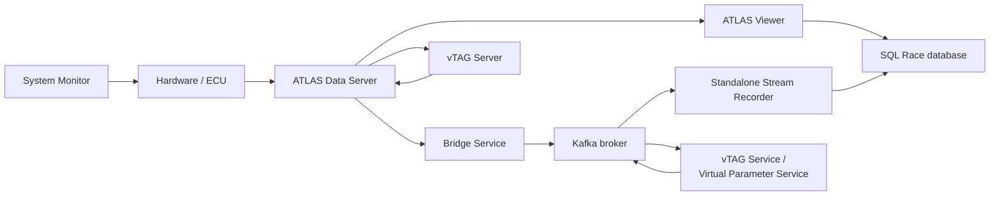

# Beyond Viewer: the rest of ATLAS

**Course step 8 of 9 · about 15 minutes**

You can do a great deal of work with Viewer alone. But the people around you may run other parts of ATLAS, and the docs refer to them constantly. This page introduces each component in one paragraph, says what question it answers, and tells you where to go next.

## Configure

### System Monitor

**The question it answers:** *what is the hardware measuring, and how is it set up?*

The application for configuring and calibrating Motion Applied ECUs and data loggers: programming units, setting up logging, managing sensors and tuning parameters. It supports trackside work, dyno testing, development and production. It is the gateway between physical hardware and the rest of ATLAS.

You will meet it if you set up units, or if you wonder where parameters and their definitions come from. → [System Monitor](../../key-functionality/configure/system-monitor/index.md)

## Stream

### ATLAS Data Server (ADS)

**The question it answers:** *how does live data reach everyone who needs it?*

The traditional live data path. ADS accepts incoming telemetry (by wirelink, radio or Ethernet) and distributes it to ATLAS clients on the local network. Servers can be daisy-chained, and the Remote Data Server lets a client listen to a server on another network across a WAN. → [ATLAS Data Server](../../key-functionality/stream/ads/index.md)

### Open Streaming

**The question it answers:** *how do I get telemetry into and out of other systems?*

A Kafka-based streaming layer with a published message schema. The **Bridge Service** decodes raw ADS data into engineering values and publishes it to broker topics. The **Stream API** and **Support Library** let you write software that reads or writes those topics. Consumers can join late, be remote, or be many. → [Open Streaming](../../key-functionality/stream/open_streaming_architecture/index.md)

## Enrich

### vTAG Server and vTAG Service

**The question they answer:** *can I add calculated data from a model?*

Both run Simulink-based models against telemetry to produce new parameters that appear alongside measured ones. **vTAG Server** works with an ADS set-up and covers live and historical data. **vTAG Service** works with Open Streaming and does not need ADS. → [vTAG Server](../../key-functionality/enrich/vtag/index.md), [vTAG Service](../../key-functionality/enrich/vtag-service/index.md)

### Virtual Parameter Service

**The question it answers:** *can everyone get the same calculated channels, computed once?*

A service that runs alongside Open Streaming and calculates FDL-defined virtual parameters centrally, so each client does not repeat the work. → [Virtual Parameter Service](../../key-functionality/enrich/vps/index.md)

## Store

### SQL Race and SQL Race Management Studio

**The question it answers:** *where do sessions live, and how does a team share them?*

SQL Race is the session data layer behind Viewer. The SQL Race database stores sessions, their configuration and their data, and supports concurrent access by a team. **SQL Race Management Studio** is the tool for organising, bulk-importing and auto-importing sessions. Sessions can also be stored as SSN2 files, or as Parquet when using Open Streaming. → [SQL Race](../../key-functionality/store/sqlrace/index.md)

## Analyse

### ATLAS Viewer and the Standalone Stream Recorder

Viewer is what this course has been about. The **Standalone Stream Recorder** is a console application that records Stream API telemetry to SSN2 files or a SQL Race database without Viewer running. → [Standalone Stream Recorder](../../key-functionality/analyse/standalone-stream-recorder/index.md)

## Integrate

### Remote Telemetry Architecture (RTA) and the APIs

**The question they answer:** *how do I connect ATLAS to what I already have, or automate it?*

RTA lets ATLAS read sessions from your own existing database through a lightweight data adapter, so you do not have to migrate. The APIs give programmatic access to sessions, to Viewer itself and to the stream. See [Automating it](automating.md). → [Integrate](../../key-functionality/integrate/index.md)

## Who usually runs what

| Role | Typically works with |
|---|---|
| **Analyst or engineer** | Viewer, sessions, workbooks, functions |
| **Data or systems engineer** | SQL Race, ADS, Open Streaming, recorders, vTAG, the APIs |
| **Hardware or controls engineer** | System Monitor, ECU configuration, logging set-up |
| **Developer** | APIs, custom displays, Stream API and Support Library |

## Next

[Automating it](automating.md) shows how to script analysis, build your own tools on the data, and extend Viewer.
