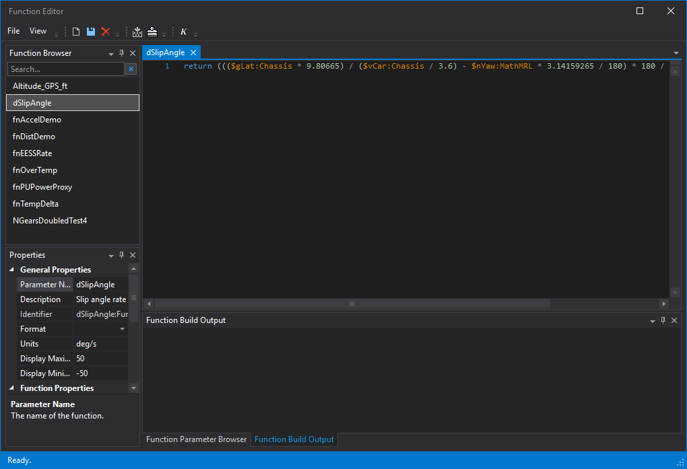

# Channels and calculated parameters

**Course step 6 of 9 · about 15 minutes**

Two skills make you fast in Viewer: finding the right signal in a large session, and creating the signals the logger did not record.

## Finding parameters

Press `P` to open the **Parameter Browser**. A parameter is identified by a name and the application group it belongs to, written `name:application`, for example `vCar:Chassis`.

| Do this | To |
|---|---|
| Choose a group on the left, or **All Groups** | Narrow the list to a subsystem, or search everything |
| Type in the search box | Search by name, description or group. Name matches are listed first |
| Use `*` in the search text | Match any characters |
| End the search with `-` or `+` | Sort A to Z or Z to A |
| Use the **Slow Row**, **Virtuals** and **Functions** toggles | Show or hide those kinds of parameter |
| Right-click a column header | Choose which columns to show, including **Units**, **Display Min** and **Display Max** |
| Press `Enter` | Add the selected parameters to the active display |

Application groups are defined by the logging system. You cannot change them in Viewer. If you want different names, use **aliasing**.

### Renaming parameters with aliasing

Aliasing lets you give parameters your own names, either by replacing a name or by picking the first available source from several, in priority order. It is configured in an `aliasing.config` file, and Viewer must be restarted for changes to apply. See [Parameter aliasing](../../key-functionality/analyse/viewer/handling-data/parameters/using-parameters.md#parameter-aliasing-changing-parameter-name).

### Properties: colour, scale, format and units

Double-click a parameter on a display to open its **Parameter Properties**. Changes can be **Local** to one display or **Global**. A `*` in the Parameter Browser flags a parameter whose properties differ from the session default. See [How Viewer is organised](viewer-model.md#properties-have-three-levels).

## Creating calculated parameters

When you need a channel that was not recorded, there is a ladder of options. Start at the lowest rung that does the job.

| If you need… | Use | Where it runs |
|---|---|---|
| Simple maths on existing parameters | **Functions in FDL** (Function Definition Language) | In Viewer. |
| Logic you already have in C# or MATLAB | **C# or MATLAB functions** | In Viewer. Reused without rewriting. |
| A Simulink model run against telemetry | **vTAG Server** | A separate application. Results appear as native parameters. |
| One agreed set of calculated channels for everyone, computed once | **Virtual Parameter Service** | A service alongside Open Streaming. |

### Your first function

1. Open the **Function Editor** from the Browser Toolbar or **View > Function Editor**.
2. Click **New**. Set a name, units and display min/max.
3. Use the Function Parameter Browser to insert the parameters, constants or other functions you need as inputs.
4. Write the calculation in the Function Definition panel.
5. Press `F6` to build and check for errors.
6. Save. The function is now available in the Parameter Browser like any other parameter.

The **Function Browser** (top left) lists the functions you already have. Double-click one to open it. Its definition opens in a tab, its name, units and display range are in **Properties** (bottom left), and errors from `F6` appear in **Function Build Output**.

!!! tip "Use the full identifier if short names do not resolve"
    If a short name does not resolve, use the full `name:application` identifier, such as `vCar:Chassis`, unless **Resolve without App Name** is enabled in **Tools > Options > General > Data**.

Functions have a **mode** that decides when and where they calculate, for example **instantaneous** (at every sample point of every input, results not stored) or **coverage cursor based** (from the start of the session to the coverage cursor, results stored). Choose it in the Function properties. See [Using the Function Editor](../../key-functionality/analyse/viewer/functions/function-editor.md) and [Processors](../../key-functionality/analyse/viewer/functions/processing.md) for ready-made routines.

Functions are stored with the data layer (SQL Race), so they persist and can be reused. See [Functions](../../key-functionality/analyse/viewer/functions/index.md).

### Choosing between the options

The [Choosing components](../ecosystem-guide.md#calculated-channels) page has a "pick this when" list for each option, including when to move calculations out of Viewer.

## Next

[Getting your data in](getting-data-in.md) covers where sessions come from, and how to get your own data into Viewer.
