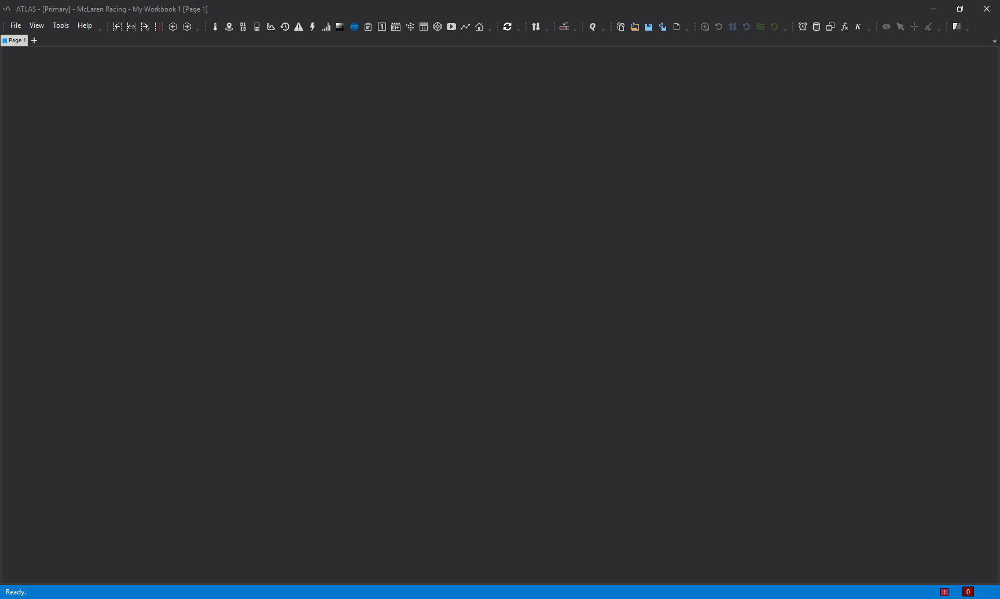
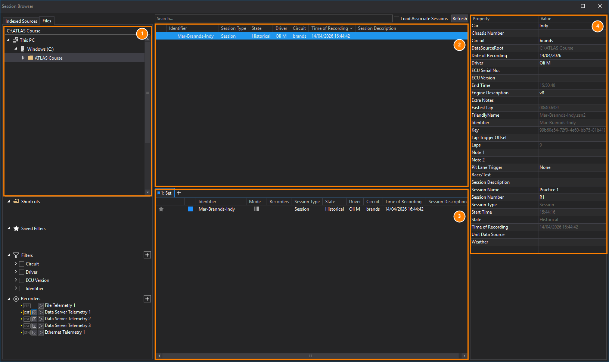
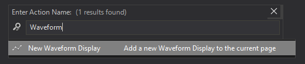
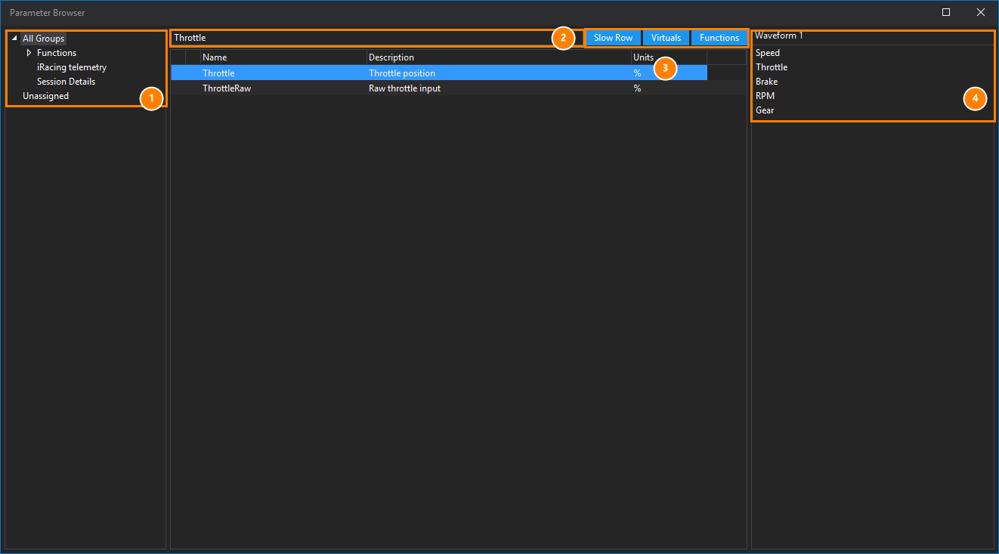
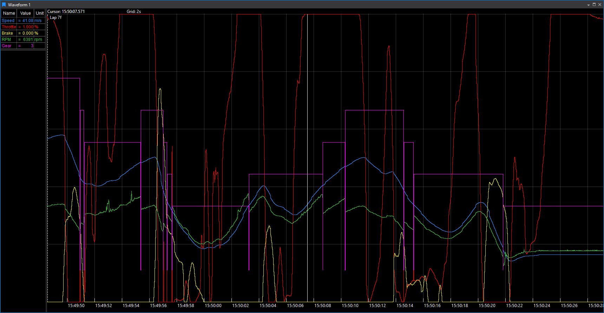

# Your first hour in Viewer

**Course step 3 of 9 · about 30 to 60 minutes**

By the end of this page you will have loaded a session, plotted parameters, moved around in time, overlaid a second session and saved your layout as a workbook. Each step links to the reference page if you want the full detail.

## Before you start

You need three things:

1. **ATLAS Viewer installed.** Versions are available from the [Motion Applied Portal](https://portal.motionapplied.com/). Check the [system requirements](../../getting-started/sysreqs.md) first (Windows 11, 16 GB RAM or more recommended).
2. **A licence.** Open the Licence Manager utility and add your licence code. Licence options decide which features appear, for example CSV/ASCII import. See [Adding a Licence](../../key-functionality/analyse/viewer/quick-start.md#adding-a-licence).
3. **Something to look at.** Ask your team for a session file (`.ssn2`) or the details of a shared SQL Race database. If all you have is a CSV file, see [Getting your data in](getting-data-in.md#delimited-text-csv-and-txt).

## 1. Start Viewer

Start **ATLAS Viewer** from the Start menu. A new workbook opens with one empty page.

The empty page is expected. Viewer has not been told what data to show yet.

## 2. Open the Session Browser and load a session

Press `Ctrl+L` to open the **Session Browser**. It has six panels. For now you need these four:

| | Panel | What to do |
|---|---|---|
| 1 | **Session Sources** | Tell Viewer where to look. Use the **Files** tab to browse to a folder of session files, or right-click and choose **Connection Manager...** for a SQL Race database. |
| 2 | **Session List** | Shows the sessions in the sources you picked, with metadata such as driver, circuit and time of recording. Use the filters or the search box to narrow down. |
| 3 | **Compare Sets List** | Shows what is loaded. Each tab is a set. |
| 4 | **Session Properties** | Shows the details of the selected session, such as car, circuit, fastest lap and number of laps. |

Select a session and press `Enter` (or double-click it). It appears in the Compare Sets List (3), which means it is loaded into the current **set**. Press `Esc` to close the Session Browser.

!!! warning "Nothing can be plotted until a session is loaded"
    This is the most common reason for a blank display. The workbook holds layout. The data comes from the set.

## 3. Add a display

Press `Ctrl+Q` twice, type `Waveform`, and press `Enter`. A **Waveform** display opens. It plots parameters against time (or distance) and is the display you will use most.

Other ways to add a display are the display toolbar and **File > New > Display**. See [Displays](../../key-functionality/analyse/viewer/displays/index.md) for all 20 or so types.

## 4. Add parameters

With the Waveform selected, press `P` to open the **Parameter Browser**.

1. The left panel lists **application groups**, which organise parameters by source or subsystem. Choose **All Groups** if you are not sure where something is.
2. Type in the search box to find a parameter by name, description or group. Use `*` as a wildcard.
3. The **Slow Row**, **Virtuals** and **Functions** toggles show or hide those kinds of parameter.
4. The right panel lists the parameters already on the selected display.

Press `Enter`, double-click, or drag a parameter onto the display to add it. Add three or four parameters, then press `Esc`. Each parameter gets a trace and a row in the legend with its value at the cursor.

!!! tip "What if the parameter I expect is missing?"
    Check **All Groups**, check that the **Functions** and **Virtuals** toggles are on if it is a calculated channel, and check the session really contains it. In the Selected Parameters list, parameters with no data are greyed out. See [Channels and calculated parameters](channels-and-calculations.md).

## 5. Move around in time

| To do this | Do this |
|---|---|
| Zoom in and out | Scroll wheel over the Waveform |
| Zoom to a region | Right-click, hold and drag to select, then choose **Zoom** |
| Scroll left and right | Hold both mouse buttons (or the middle button) and move the mouse |
| Place the cursor | Click in the display. The cursor is synchronised across displays |
| Jump to the start or end | `Home` / `End` |
| Select a whole lap | Double-click it in the **Timeline** along the top |

The **Timeline** at the top of the window shows the session length and its laps, and controls what time range the displays show.

1. The loaded session and the lap shown. `Lap 7f` means lap 7, the fastest lap. Click the arrow to pick another lap.
2. **Previous Lap** and **Next Lap**.
3. The whole session. Each white block is a lap, and the shaded region is the time range the displays show.

See [Timebase and Timeline](../../key-functionality/analyse/viewer/time-and-position/time.md).

## 6. Overlay a second session

Back in the Session Browser (`Ctrl+L`), select a second session and press `Enter`. It joins the same set, and the Waveform shows both, with a header and colour stripe for each session in the legend.

Two other ways to load a session, which you will want later:

| Keys in the Session List | Result |
|---|---|
| `Enter` | Add to the current set |
| `Ctrl+Enter` | Add to a **new** set |
| `Shift+Enter` | **Replace** the sessions in the current set |

With more than one set, `Shift+1`, `Shift+2` and so on point the selected display at that set, and `Ctrl+1`, `Ctrl+2` point every display on the page. See [Loading sessions](../../key-functionality/analyse/viewer/handling-data/sessions/loading-sessions.md).

## 7. Save your workbook

Press `Ctrl+S` to save. Viewer writes a `.wbkx` file holding your pages, displays, positions and properties.

!!! warning "Viewer does not auto-save"
    Save regularly. By default Viewer keeps a few backups of previous saves, so you can recover an earlier version. See [Workbooks and pages](../../key-functionality/analyse/viewer/system-operation/workbook.md).

Next time, `Ctrl+O` re-opens it. Because the workbook holds layout and not data, you can load a different session, and the same plots work.

## Check yourself

You are ready to move on if you can:

- [ ] Explain why a display is blank before any session is loaded.
- [ ] Load a session and add parameters from the Parameter Browser.
- [ ] Zoom to a region and jump to a lap.
- [ ] Put two sessions in one set and tell them apart in the legend.
- [ ] Save and re-open a workbook.

## If something does not look right

| Symptom | Try |
|---|---|
| The Session Browser is empty | Add a source (folder or database) in **Session Sources**, then press `F5` to refresh. |
| A session will not load | Check your licence options and that the file or database is reachable. |
| Display shows "No Data" | Check the cursor is inside the data range, and that the parameter has data at that time. |
| Everything is slow | Reduce the number of parameters per display, close displays you are not using, and zoom to the area of interest. |

More in [Working with displays](../../key-functionality/analyse/viewer/displays/essentials.md#troubleshooting).

## Next

[How Viewer is organised](viewer-model.md) puts names on what you just did, so the rest of the docs read more easily.
