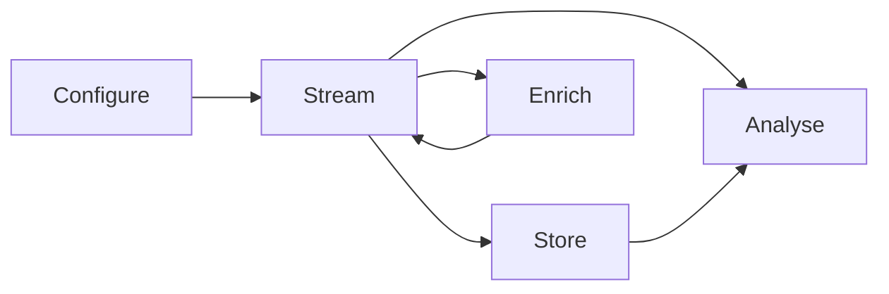

# The five stages

**Course step 2 of 9 · about 10 minutes**

ATLAS is organised around the journey of data, from the hardware that measures it to the person who studies it. Once you know these five stages, each product name in the docs has a place to sit.



| Stage | The question it answers | Main components | Do you need it? |
|---|---|---|---|
| [Configure](../../key-functionality/configure/system-monitor/index.md) | What is being measured, and how? | **System Monitor** | Only if you set up or calibrate hardware. |
| [Stream](../../key-functionality/stream/index.md) | How does live data get from the source to people? | **ATLAS Data Server (ADS)**, **Open Streaming** (Bridge Service, Stream API) | Only for live data. Not needed for files. |
| [Enrich](../../key-functionality/enrich/index.md) | Can we add calculated or modelled data? | **vTAG Server**, **vTAG Service**, **Virtual Parameter Service** | Optional. |
| [Store](../../key-functionality/store/index.md) | Where does the data live afterwards? | **SQL Race** database, SQL Race Management Studio, SSN2 files | Almost always, in some form. |
| [Analyse](../../key-functionality/analyse/index.md) | How do I look at it and compare it? | **ATLAS Viewer**, Standalone Stream Recorder | Yes. This is where most analysts work. |

A sixth area, [Integrate](../../key-functionality/integrate/index.md), cuts across all five. It covers the APIs and the Remote Telemetry Architecture (RTA) for connecting ATLAS to other systems.

!!! tip "You are probably here"
    If you were handed a session and a workbook and asked to find something out, you work in **Analyse** only. Someone else configured the hardware, ran the streaming and set up the database. You will want to know they exist, and can come back to the other stages when you need them.

## Three common set-ups

These are the shapes you are most likely to meet. A real deployment is often a mix.

=== "Offline analysis"

    The simplest set-up. You have recorded sessions as files or in a shared database, and you analyse them in Viewer.

    ```mermaid
    graph LR
        S["Sessions<br/>(files or SQL Race database)"] --> V["ATLAS Viewer"]
    ```

    Components you need: **Viewer**, plus the storage the sessions are in.

=== "Live data on a local network"

    The traditional ATLAS live path. Hardware sends telemetry to an ATLAS Data Server, which distributes it to Viewer clients on the same network. Each Viewer records what it receives into a session.

    ```mermaid
    graph LR
        H["Hardware<br/>(ECU / data logger)"] --> A["ATLAS Data Server"]
        A --> V["ATLAS Viewer<br/>(Data Server Telemetry recorder)"]
        V --> D["SQL Race database"]
    ```

    Components you need: **System Monitor** (to set up the hardware), **ADS**, **Viewer**, **SQL Race**.

=== "Open Streaming"

    A Kafka-based path. Raw data from ADS is decoded and published to topics that any number of independent consumers can read, including consumers that join late or live in the cloud.

    ```mermaid
    graph LR
        A["ATLAS Data Server"] --> B["Bridge Service"]
        B --> K["Kafka broker"]
        K --> V["ATLAS Viewer<br/>(Stream Recorder)"]
        K --> R["Standalone Stream Recorder"]
        K --> X["Your own services<br/>(Stream API)"]
    ```

    Components you need: **Bridge Service**, a broker, and one or more consumers. See [Open Streaming](../../key-functionality/stream/open_streaming_architecture/index.md).

## Choosing between options

When you reach a point where there are several ways to do something (which storage, which distribution path, how to calculate a derived channel), [Choosing components](../ecosystem-guide.md) lays out the options with a "pick this when" list for each.

## Next

[Your first hour in Viewer](first-hour.md) is the practical step. Load a session, plot a few parameters and compare two runs.
