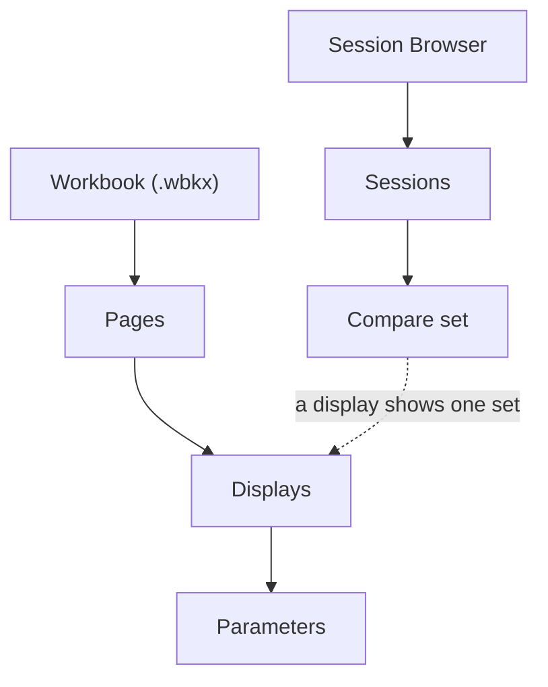

# How Viewer is organised

**Course step 4 of 9 · about 10 minutes**

In the previous step you loaded data and drew plots. This page names the pieces, and shows how they connect. Once the model is clear, the Viewer reference pages become much easier to navigate.

## The model in one picture

In words:

> **Sessions** are loaded into **compare sets** using the **Session Browser**. A **workbook** holds **pages**, pages hold **displays**, and each display shows **parameters** from the set it is pointed at.

The dotted line matters most. A display is not attached to a particular file. It is attached to a *set*, and whatever is in the set is what you see.

## The pieces

| Piece | What it is | Where to learn more |
|---|---|---|
| **Session** | One recording, with metadata, laps, events and parameter data. Historical (finished) or live (still arriving). | [Sessions](../../key-functionality/analyse/viewer/handling-data/sessions/index.md) |
| **Session Browser** | The place you find, load, record and manage sessions. `Ctrl+L`. | [Session Browser](../../key-functionality/analyse/viewer/handling-data/sessions/browser.md) |
| **Compare set** | One or more sessions loaded together. Displays point at a set. Sessions in the same set overlay. | [Loading sessions](../../key-functionality/analyse/viewer/handling-data/sessions/loading-sessions.md) |
| **Composite session** | Several sessions appended into one continuous timeline, with a green separator where they join. | [Loading sessions](../../key-functionality/analyse/viewer/handling-data/sessions/loading-sessions.md#what-is-a-composite-session) |
| **Workbook** | Your saved workspace: pages, displays, their layout and properties. | [Workbooks and pages](../../key-functionality/analyse/viewer/system-operation/workbook.md) |
| **Page** | A tab within a workbook that holds displays. Group related displays on a page. | [Workbooks and pages](../../key-functionality/analyse/viewer/system-operation/workbook.md#working-with-pages) |
| **Display** | A single visualisation: Waveform, Numeric, Scatterplot and so on. | [Displays](../../key-functionality/analyse/viewer/displays/index.md) |
| **Parameter** | A measured signal (or a calculated one). Grouped by application. | [Parameters](../../key-functionality/analyse/viewer/handling-data/parameters/index.md) |
| **Timebase and Timeline** | The time range displays show, and the control for it. | [Timebase and Timeline](../../key-functionality/analyse/viewer/time-and-position/time.md) |

## What is saved where

| Thing | Saved in | Notes |
|---|---|---|
| Sessions and their data | A SQL Race database, or an `.ssn2` / `.ssn` file | Not in the workbook. |
| Layout, display properties | Workbook (`.wbkx`) | Save with `Ctrl+S`. Not auto-saved. |
| Functions, alarms, circuit definitions, bit configuration files | Separate files opened with the workbook | If they are missing, displays that need them appear empty. |
| Your settings and files as a bundle | Configuration bundle (`.acgx`) | Use **Tools > Import/Export Configuration** to share a set-up with a colleague. |

## Properties have three levels

When you change how a parameter or display looks (colour, scale, format), Viewer remembers *how widely* the change applies. The icon next to each property tells you:

| Icon | Level | Meaning |
|---|---|---|
| ◻️ Square | **Default** | The value from the data source. |
| ♦️ Diamond | **Local** | Changed for this display only. |
| ⚪ Circle | **Global** | Applies to all displays of this type, including new ones. |

If a colour changed everywhere and you did not mean it to, a global property is the likely cause. Right-click the property and choose **Clear Global Value**.

## Eight shortcuts worth learning first

| Keys | Does |
|---|---|
| `Ctrl+L` | Open the Session Browser |
| `Ctrl+Q` twice | Quick access: add a display by name |
| `P` | Open the Parameter Browser |
| `D` | Open Display Properties |
| `Shift+1` … `Shift+0` | Point the selected display at set 1 to 10 |
| `Ctrl+1` … `Ctrl+0` | Point the whole page at set 1 to 10 |
| `Ctrl+S` | Save the workbook |
| `F1` | Open the built-in help |

The full list is in [Keyboard shortcuts](../../key-functionality/analyse/viewer/system-operation/keyboard.md).

## Next

[Laps, markers and comparing runs](laps-and-comparison.md) uses these pieces for the job most analysts do every day.
