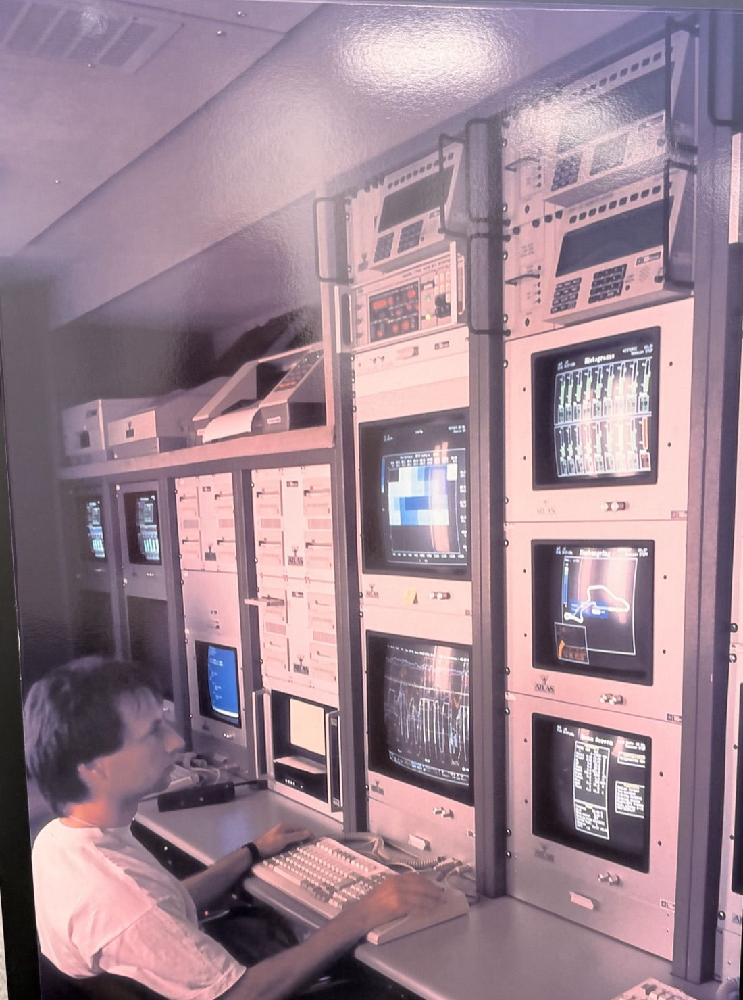
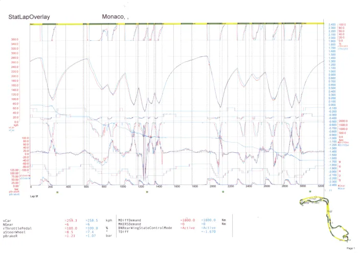
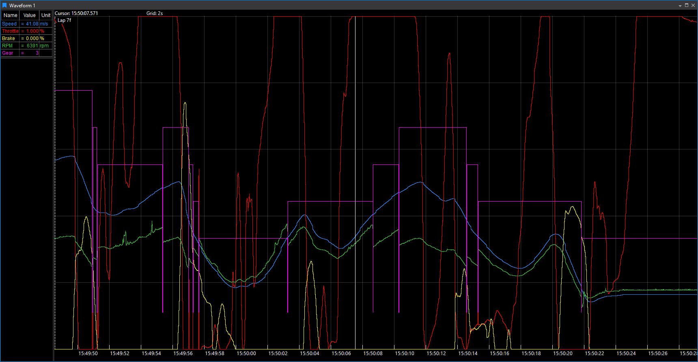

# The History of ATLAS

In 1991 the first TAG telemetry system for Group C sportscars rode around in an articulated trailer, and every view had a monitor of its own. Today ATLAS Viewer puts more than 20 kinds of display on whatever screens you have, and we have not needed a trailer in a while. This is how a trailer became a platform.

We started out as TAG Electronic Systems in 1988. Since then we have also been McLaren Electronic Systems and McLaren Applied, and we are now Motion Applied. ATLAS (Advanced Telemetry Linked Acquisition System) has come along for every one of those names.

!!! note "A note on names"
    Historically, "ATLAS" meant the application engineers used to look at data. Today **ATLAS** is the whole ecosystem and **ATLAS Viewer** is that application. This page says "ATLAS" for the product as it was known at the time, and "ATLAS Viewer" for the application today. See [Start here](index.md) for the ecosystem as it is now.

## The trailer, 1991

Our oldest picture of ATLAS is a photograph of a trailer. Inside was the first TAG telemetry system for Group C, and the racks already carry the ATLAS name.

<figure markdown>
  { width="380" }
  <figcaption>ATLAS trailer · 1991 · Articulated trailer containing the 1st TAG telemetry system for Group C</figcaption>
</figure>

Look at the screens and you will spot some old friends. One is titled "Histograms" and is full of bar gauges. Another shows a circuit map with the car's position on it. Below them are strip-chart traces and a "Main Screen" of values, and there is a block-colour plot too. Every view has a rack-mounted monitor of its own, which makes this the original multi-monitor set-up, and each one wears an ATLAS badge. Histograms, circuit maps and traces were all there in 1991, and all three are still display types today.

The person behind it was Dr Udo Zucker, who led TAG Electronic Systems. Before that he had developed the electronic ignition and injection control for the TAG-Porsche engine in McLaren's 1984 MP4/2.[^zucker] Our first big contract was Mercedes-Benz's Group C programme. Motor Sport's 1991 look at the Mercedes C291 confirms that we supplied the engine management and a comprehensive telemetry system, which Zucker said sent five million bits of information per second.[^c291]

!!! info "Got an archive?"
    We are still hunting for the first dated reference to the ATLAS name, and for descriptions of the earliest screens. The earliest dated statement we have found is iRacing's 2011 release, which says ATLAS was developed in the 1990s to support McLaren's own Formula 1 team.[^iracing] If you have material from the period, we would love to see it.

## Into the paddock, 1992 to 2007

Honda's departure sent McLaren to our control systems for 1993, and the telemetry came with them. McLaren credits us with the MP4/8's engine management, chassis control, data acquisition and telemetry.[^mp48]

The next decade was about making everything smaller, faster and smarter. In 2000 we introduced 32-bit PowerPC ECUs, with software generated automatically from model-based design tools.[^ecu2000] The TAG-310, ancestor of the standard ECU, first ran in 2005.[^tag310] In 2006 we won the FIA's contract to supply the standard ECU from 2008, together with Microsoft, and our managing director, Peter van Manen, could say that we already worked with all the F1 teams.[^microsoft]

ATLAS was growing up too. It became a client–server system on the Windows desktop, with an ATLAS Server built first in Visual Studio 2005, then 2008. Remote Data Servers could be daisy-chained, so the track, the factory and the engine supplier could all watch the same live telemetry at once.[^f1dict] The client ran on garage laptops under Windows XP or Vista, with Excel 2007 alongside for further analysis. Exactly when ATLAS made the jump from dedicated monitors to the desktop is one of the things we are still working out.

## The paddock standard, 2008 to 2017

From 2008 our standard ECU was on every F1 car, and ATLAS had become the standard data package in the paddock.[^scarbs]

### A lap at Monaco

Our favourite picture of ATLAS 9 at work is a printout from the 2011 Monaco Grand Prix, analysed by data engineer Brian Jee.[^scarbs]

<figure markdown>
  { width="640" }
  <figcaption>A lap overlay printout from the 2011 Monaco Grand Prix, analysed by data engineer Brian Jee</figcaption>
</figure>

It tells a whole story on one page:

- Two drivers, two laps, overlaid in red and blue against lap distance.
- A cursor that reads the exact value on every trace as it moves.
- A time-difference (TDiff) trace that ATLAS draws automatically whenever layers are overlaid, so you can see where time was won and lost.
- A dot on a track map that follows the cursor. ATLAS built the map from lateral acceleration and distance data, and coloured the corners by lateral-acceleration thresholds.

Then it went to the drivers as a printout in the garage.

ATLAS 9 worked like a spreadsheet: a workbook of pages, and on each page the displays an engineer had built. They chose from nine kinds: Waveform, Scatter, Circuit, Histogram, Summary, FFT, Map, Bar and InPlace, which hosted ActiveX controls with full access to the data.[^sheet]

### Beyond Formula 1

ATLAS turned out to be good company away from the F1 grid too.

-   :material-flag: __NASCAR__

    ---

    In 2011 we became NASCAR's official ECU supplier, and electronic fuel injection made its debut at the 2012 Daytona 500.[^ecu2000]

-   :material-flash: __Formula E__

    ---

    We supplied the motor, transmission and electronics for the first Spark-Renault car.[^fe]

-   :material-controller: __Sim racing__

    ---

    In May 2011 we gave iRacing members ATLAS Express, a version derived from the F1 software, for analysing their own racing data.[^iracing] Its set-up guide even shipped a sample workbook.[^guide]

## Rebuilt from the ground up, 2018 to 2021

Around 2018 to 2019 we rebuilt it. ATLAS 10 was a new visualisation platform "built from the ground up" for faster, easier access to data.[^atlas10] We designed ATLAS 9 and ATLAS 10 to run side by side, so nobody had to switch overnight.

-   :material-puzzle-outline: __A platform for plugins__

    ---

    ATLAS became a shell in which most functionality, from displays to recorders, comes from plugins.[^plugins] Developers could write their own display plugins in .NET. Today that is the [Display API](../developer-resources/atlas/display-api/index.md).

-   :material-lan-connect: __Open to other tools__

    ---

    Engineers could feed data from third-party tools into ATLAS 10 and see it next to everything else.[^racetech]

-   :material-compare: __Compare sets__

    ---

    A feature of ATLAS 10,[^compare] and still how Viewer overlays runs today.

Race Tech reported in March 2019 that teams would be evaluating ATLAS 10 that season. Our support site carried a provisional 2018 F1 release schedule, and guidance on importing ATLAS 9 workbooks.

## How far we have come

In 1991 an engineer sat at one keyboard in front of racks of monitors, one for each view. Thirty-five years later, the ideas on those screens have held up: traces against time or distance, a cursor that reads every value, overlaid laps with a time difference, and workbooks of pages of displays. Everything around them has grown.

  
<strong>35 years</strong>since the trailer photograph

  
<strong>9 → 20+</strong>display types

  
<strong>3 APIs</strong>and a plugin platform

  
<strong>5 stages</strong>from configuring hardware to analysing data

<figure markdown>
  { style="object-position: 50% 75%" }
  <figcaption><strong>1991</strong>A monitor for every view</figcaption>
</figure>

<figure markdown>
  
  <figcaption><strong>2011</strong>Laps overlaid, with TDiff, and printed for the garage</figcaption>
</figure>

<figure markdown>
  
  <figcaption><strong>Today</strong>Any number of displays, on any screens you like</figcaption>
</figure>

Here is what changed, piece by piece.

-   __One trailer → a whole ecosystem__

    ---

    ATLAS Viewer now sits in a chain that runs from configuring hardware, through streaming and enriching data, to storing and analysing it. Take the tour in [The five stages](course/five-stages.md).

-   __A monitor per view → any monitors you like__

    ---

    Displays dock or float, group into pages, and are saved in workbooks.

-   __Nine displays → more than twenty__

    ---

    Including a 3D Surface Map, a Bing satellite map, video and a steering-wheel PCU Dash simulator. See all the [displays](../key-functionality/analyse/viewer/displays/index.md).

-   __Two laps on paper → compare sets, live__

    ---

    Overlay several sessions, with TDiff in the [Waveform display](../key-functionality/analyse/viewer/displays/waveform.md). Learn how in [Laps, markers and comparing runs](course/laps-and-comparison.md).

-   __Excel on the side → functions inside Viewer__

    ---

    Write [functions](../key-functionality/analyse/viewer/functions/index.md) in FDL, C# or MATLAB, and run Simulink models through vTAG.

-   __ActiveX controls → plugins and three APIs__

    ---

    The [Display](../developer-resources/atlas/display-api/index.md), [Automation](../developer-resources/atlas/automation-api/index.md) and [SQL Race](../developer-resources/atlas/sql-race/index.md) APIs.

-   __Printouts in the garage → one shared database__

    ---

    A SQL Race database a whole team can use at once, plus session references and configuration bundles.

-   __Daisy-chained servers → and Open Streaming__

    ---

    The same live path, plus a [Kafka-based layer](../key-functionality/stream/open_streaming_architecture/index.md) that remote or late-joining consumers can read.

## Where to go next

- [Start here](index.md): the ecosystem today, and a short course for new users.
- [ATLAS Viewer](../key-functionality/analyse/viewer/index.md): the current application.
- [Release notes](../blog/index.md): what we are changing now.

[^zucker]: [Formula1.com: how Niki Lauda's final title-winning car, the 1984 McLaren MP4/2, changed F1](https://www.formula1.com/en/latest/article/how-niki-laudas-final-title-winning-car-the-1984-mclaren-mp4-2-changed-f1.7vGiQXahtUbaKo70ZJ8OGQ). Motion Applied's own [history page](https://motionapplied.com/about/our-history/) names the Mercedes-Benz Group C programme as our first large contract.
[^c291]: [Motor Sport, July 1991: Under scrutiny, Mercedes C291](https://www.motorsportmagazine.com/archive/article/july-1991/34/under-scrutiny-mercedes-c291/?v=7516fd43adaa).
[^iracing]: [iRacing, 2011: iRacing partners with McLaren Electronic Systems](https://www.iracing.com/iracing-partners-with-mclaren-electronic-systems-for-online-racing-data-analysis/).
[^mp48]: [Motor Sport, May 2024](https://www.motorsportmagazine.com/archive/article/may-2024/70/sennas-underdog-f1-success-the-special-talent-and-nimble-mclaren-that-won-five-times-in-1993/) on McLaren's 1992 and 1993 seasons, and [McLaren heritage: the 1993 MP4/8](https://www.mclaren.com/racing/heritage/formula-1/cars/1993-formula-1-mclaren-mp4-8/).
[^ecu2000]: [Electronics Weekly: embedded processing at McLaren](https://www.electronicsweekly.com/market-sectors/embedded-systems/embedded-processing-at-mclaren-2012-06/).
[^tag310]: [New Electronics: developing an engine control unit for all F1 teams](https://www.newelectronics.co.uk/content/features/racing-ahead-developing-an-engine-control-unit-for-all-f1-teams).
[^microsoft]: [Microsoft, 11 December 2006: Microsoft and McLaren Electronic Systems win the FIA contract](https://news.microsoft.com/source/2006/12/11/microsoft-and-mclaren-electronic-systems-win-race-to-provide-electronic-technology-to-the-fia-formula-one-world-championship-for-2008-to-2010/).
[^f1dict]: [formula1-dictionary: F1 ECU and the ATLAS architecture](https://www.formula1-dictionary.net/f1-ecu-electronic-control-unit/).
[^scarbs]: [ScarbsF1, 2011: Telemetry and data analysis introduction](https://scarbsf1.wordpress.com/2011/08/18/telemetry-and-data-analysis-introduction/).
[^sheet]: [ATLAS product sheet](https://www.scribd.com/document/480702902/ATLAS-pdf), undated.
[^fe]: [Motorsport.com, 2013: McLaren, the power behind Formula E](https://www.motorsport.com/formula-e/news/mclaren-the-power-behind-formula-e/440037/).
[^guide]: [McLaren ATLAS iRacing set-up guide](https://www.scribd.com/document/352980261/McLaren-ATLAS-iRacing-pdf), which installs into an "ATLAS 9" folder.
[^atlas10]: [ATLAS 10 support section](https://mclarenappliedtechnologies.zendesk.com/hc/en-us/sections/360000858514-ATLAS-10).
[^plugins]: [Motion Applied: ATLAS](https://www.motionapplied.com/products/ATLAS) and [Writing a Display Plugin](https://mclarenappliedtechnologies.zendesk.com/hc/en-us/articles/115001760613-Writing-a-Display-Plugin).
[^racetech]: [Race Tech, 2019: Five F1 tech facts every fan should know](https://www.racetechmag.com/article/five-f1-tech-facts-every-fan-should-know/).
[^compare]: [ATLAS 10 Automation API notes](https://mclarenappliedtechnologies.zendesk.com/hc/en-us/articles/360009038334-ATLAS-10-Automation-API), which list compare sets as ATLAS 10-only functionality.
