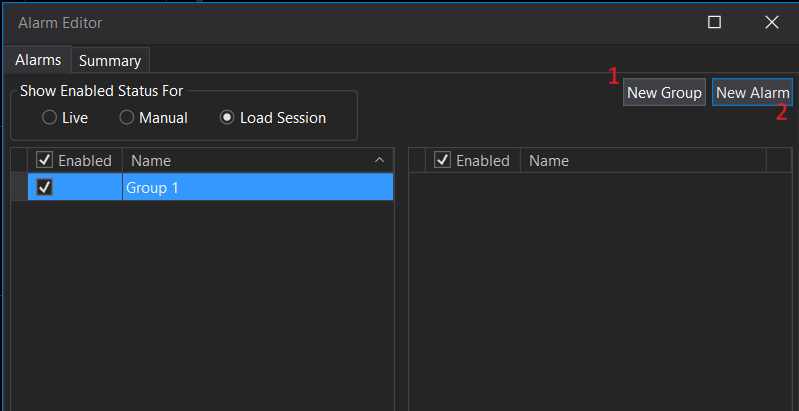
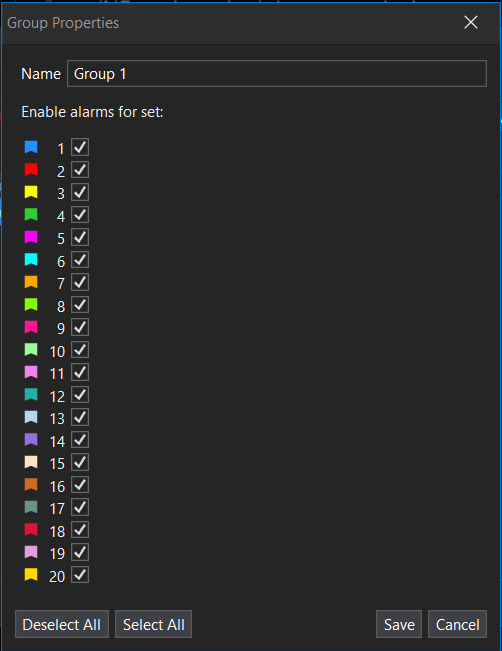
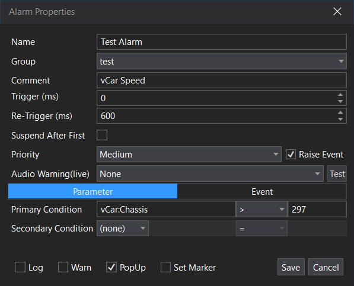
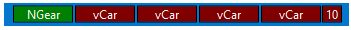
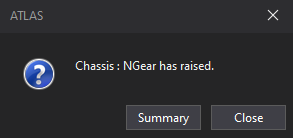
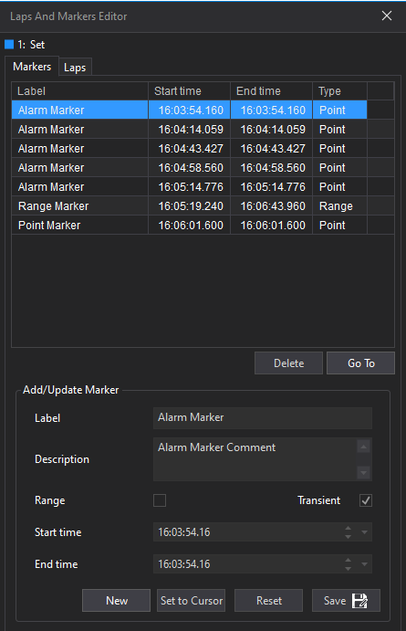
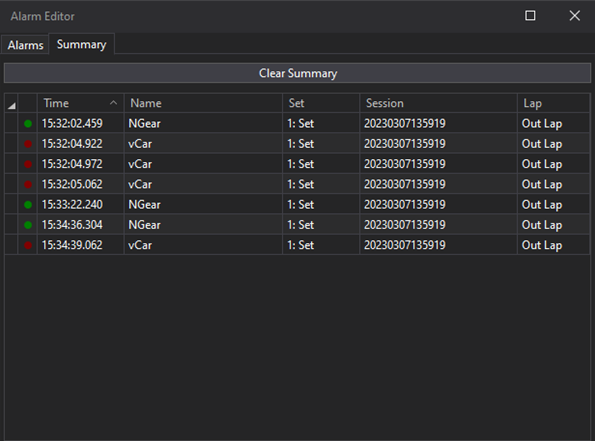

# Using Alarms in ATLAS

## Creating a new alarm

On the alarm itself you can define behaviour, conditions and actions. 

To create a new alarm go to `Tools -> Alarm Editor` and create or select an alarm group and then click `New Alarm`.

In the Alarm Editor:

- Tick **Enabled** on a group or alarm to turn it on or off. **Enable All** and **Disable All** change every alarm at once.
- **Show Enabled Status For** chooses whether the tick boxes show and set the status for **Live**, **Manual** or **Load Session** evaluation, so you can enable an alarm for live running but not for session load, for example.
- Double-click an alarm or group to edit it. Press `Delete` to delete the selected alarm or group.
- A coloured dot shows each alarm's build status. Hover over it for details: **Validated** means the alarm is compiled and ready to use; **Failed** or **Unknown** means you should check the ATLAS log.

You can double click an alarm group to change which sets are active for the alarms in that group (**Enable alarms for set:**, with **Select All** and **Deselect All**). This means that even if the condition of an alarm is met, it will not trigger from the parameters in that set if the group is not active for that set.

## Alarm Properties

### Alarm Conditions 

A parameter condition has a primary (required) and a secondary (optional) condition. The primary condition is the main condition that must be met for the alarm to trigger. The secondary condition can be used to add additional criteria that can also be satisfied for the alarm to activate. 

An event condition is based on an event ID and does not have primary or secondary conditions.

**Primary Conditions**

`Parameter + Operator + Value`

**Secondary Conditions**

`Logical Operator + Parameter + Operator + Value`

**Event Condition**

`Event ID`

The operators are `<`, `<=`, `=`, `<>`, `>=` and `>`. The logical operators for a secondary condition are **And**, **And Not**, **Or**, **Or Not**, **Xor** and **Xor Not**. Enter an **Event Id** as a hex value, for example `0x1471`.

### Alarm Behaviour

- **Priority**: **High**, **Medium** or **Low**. Priority sets the colour of the alarm in the status bar and the order alarms are shown in.
- **Trigger (ms)**: The alarm is raised only once its condition has been met for this long, so brief spikes do not raise it.
- **Re-Trigger (ms)**: If the condition is still active after the alarm is raised, the alarm is raised again after this interval.
- **Suspend After First**: Suspends the alarm after its first occurrence in a session, so a known issue does not keep raising it.

### Alarm Actions

Actions are what happens when an alarm is triggered. 

**Warn**

If Warn is selected as an action, the Status Bar shows a running count and the last five raised alarms.

**Audio Warning**

If **Audio Warning(live)** is selected as an action, a sound plays when the alarm triggers in a live session, so you hear it without looking at the screen. You can configure the sound as **None**, **Text To Speech**, or **Sound Effect**, and click **Test** to hear it.

**Pop-up**

If PopUp is an action, a dialog displays when the alarm triggers. The pop-up shows the alarm name and comment, and a **Summary** button that opens the Alarm Summary. Pop‑ups are configured with **Alarm Popup Mode** in Options → Plugins with three modes: Per Alarm (reuse per alarm), Per Occurrence (new for each trigger), Shared (one shared dialog for subsequent triggers). 

**Log**

If Log is an action, entries are written to Alarms.log.

**Raise Event**

If Raise Event is an action, ATLAS raises an event in the **Alarms** group when the alarm triggers.

**Set Marker**

If Set Marker is an action, ATLAS places a transient point marker at the trigger time/distance, labeled with the Alarm Name and using the Comment as description. These markers are not persisted and are removed when the session unloads; you can view them via the Graphical Timeline dropdown and in [Laps and Markers Editor](../handling-data/laps-markers/markers.md).

## Monitoring 

Each triggered alarm will log in the Summary, listing priority, time, name, set, session and lap. Selecting an alarm in the Summary will highlight the trigger time in the session. Click **Clear Summary** to empty the list. 

### Alarms in the status bar

With **Warn** selected, raised alarms appear in the status bar, coloured by priority, with a count of raised alarms. Hover over an alarm to see its name.

- Double-click the status bar alarms to open the Alarm Summary.
- `Ctrl`+right-click an alarm to dismiss it.
- `Ctrl`+`Shift`+right-click an alarm to dismiss all alarms of the same kind.
- Right-click for **Dismiss Alarms**, **Dismiss High Priority Alarms**, **Dismiss Medium Priority Alarms** or **Dismiss Low Priority Alarms**.

## Checking past data

To look for alarm conditions in data you have already loaded, use the manual run buttons in the Alarm Editor: **Apply for current timebase**, **Apply from cursor to end** or **Apply for whole** session. Alarms must be enabled for **Manual** evaluation.

## Alarm options

The alarm options in Tools > Options > Plugins include:

- **Alarm library**: The folder your alarms are stored in.
- **Additional Alarm File**: A further alarm file to load, for example a shared team library.
- **Delayed Parameter Range**: How far behind the leading edge live alarms look, in `m:ss`. The recommended value is 3 seconds; larger values can cause performance issues.

If you change an alarm or group that comes from an external file, ATLAS warns you that it will copy the group to your local library, and load it from there in future.
