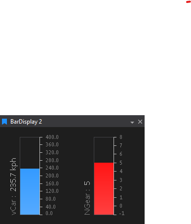

# Bar Display

 Instantaneous value of selected parameters as vertical bars with numeric readouts. Updates in real time with telemetry. Up to 16 parameters. Double‑click a bar to edit that parameter’s properties.

 

## Adding a Bar Display

To add a Bar Display to a Page do one of the following:

- Click the Bar Display button  on the Display Toolbar.

- Click `File > New > Display` and select Bar Display.

- Press `Ctrl + Q` twice to use the Quick Access Assistant and select New Bar Display.

You can now use the Parameter Browser to add some Parameters to set up the display as required.

Any number of bar graph displays can be opened at the same time.

The display updates in real time with the reception of Telemetry data.

If there are more bars than fit across the display, scroll horizontally to reach the rest. Click a bar to select its parameter.

## Display Properties

Press `D` with the display selected to open Display Properties.

| Property | Description | Default |
|---|---|---|
| **Show Parameter** | Shows the parameter name, current value and units | On |
| **Show Interval Markers** | Shows scale intervals on the bar | On |
| **Show Statistic Indicators** | Shows markers and a `Min: Max:` readout for the current lap minimum and maximum | On |
| **Use Limit Colours** | Colours the bar by the parameter's warning and critical limits instead of the parameter colour | Off |
| **Background Colour** | The display's background colour | |
| **Auto Refresh Rate (Hz)** | How often the display updates when data is panning automatically | |

The number of scale intervals for each parameter is set by **Number of Axis Intervals** in the **Axis** section of Parameter Properties.

## Spotting out-of-limit values

With **Use Limit Colours** on, the bar is green when the value is in range, blue when it is outside its warning limits, and red when it is outside its critical limits.

The current lap minimum and maximum markers use the same colours whatever **Use Limit Colours** is set to. A marker that turns blue or red shows that the value went outside its warning or critical limits at some point on the current lap, even if it is back in range now.
