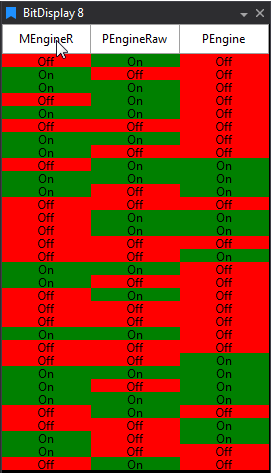

# Bit Display

Status bits of one or more parameters, with configurable On/Off colours, labels, and captions per bit. You can pick which bits are active for each parameter.



## Adding a Bit Display

To add a Bit Display to a Page do one of the following:

- Click the Bit Display button on the DisplayToolbar.

- Click `File > New > Display` and select Bit Display.

- Press `Ctrl + Q` twice to use the QuickAccess Assistant and select New Bit Display.


To select which Bits you want to show for each Parameter:

1. Right click the column on the Display for the required Parameter.

2. Select Show Bit Options or Double Click a Parameter name on the Display headers

3. Choose from the following options for each Bit:


| Option      | Description                                             | Default Value      |
|-------------|--------------------------------------------------------|--------------------|
| **Active**  | Whether the Bit is shown or not                        | On                 |
| **Caption** | Text caption for that Bit. Shown when no On or Off label is set | `Bit N`   |
| **Off Colour** | Colour displayed when that Bit is off               | Red                |
| **Off Label**  | Text label displayed when that Bit is off           | None                  |
| **On Colour**  | Colour displayed when that Bit is on                | Green              |
| **On Label**   | Text label displayed when that Bit is on            | None                  |
| **Linked Page** | Page to open when you `Ctrl`+click the Bit on the display | None           |

Bit Options also has **Activate All**, **Clear All**, **Default All** and **Undo All** buttons, and a right-click menu on each row with **Set to Default** and **Undo**. Press `Esc` to close Bit Options.


You can also quickly set up your Bit Display by loading a `.bcg` (Bit Configuration) file.

### Using a Bit Configuration File

- The location of the `.bcg` file can be set in **Tools > Options > Plugins > Bit Display**.
- Each Bit Display can be configured using the same `.bcg` file, with settings based on the parameter shown.

#### File Format

Each line in the `.bcg` file configures bits for a specific parameter. All bit definitions for a parameter must be on the same line.

**Format:**
```
ParameterName,BitNumber,Show(1|0),Caption,OffColor(decimal),OnColor(decimal),OffLabel,OnLabel,BitNumber,Show(1|0),Caption,OffColor(decimal),OnColor(decimal),OffLabel,OnLabel,...
```

- `ParameterName`: Name of the parameter.
- `BitNumber`: Zero-based index of the bit.
- `Show`: `1` to show, `0` to hide.
- `Caption`: Text caption for the bit.
- `OffColor` / `OnColor`: Color when bit is off/on, as a decimal value of the C++ `COLORREF` format (`0x00BBGGRR`). To convert an RGB hex colour (`0x00RRGGBB`), swap the red and blue bytes and convert to decimal. For example, `255` is red and `65280` is green.
- `OffLabel` / `OnLabel`: Text label when bit is off/on.

**Example:**
```
Status,0,1,Power,255,65280,Off,On,1,1,Error,255,65280,No,Yes
```

For custom colors, convert the hex value to decimal after reordering. For example, `0x00877D7C` becomes `0x007C7D87` and is written as `8158599`.

!!! note
    The Bit Display will use the `.bcg` file only after you open **Bit Options** (double-click a parameter header) and check the **Use bit config file?** option. The display will then refresh with the new configuration.

To share a configuration, right-click the display and select **Export Bit Configuration**.

## Display Properties

Press `D` with the display selected to open Display Properties. A Bit Display can show up to 20 parameters.

| Property | Description | Default |
|---|---|---|
| **Show Tell Tale Boxes** | Draws a Bit's text extra bold after it changes, so short pulses are not missed | Off |
| **Min On Time (secs)** | How long the tell tale highlight stays on after a Bit changes | 10 |
| **Hide Inactive Bits** | Removes inactive Bits so the active Bits fill the space evenly | Off |
| **Hide Headers** | Hides the headers. They still appear when you move the mouse over the display | Off |
| **Reverse Bit Order** | Reverses the displayed Bit order. By default the first Bit is at the top or left | Off |
| **Orientation** | Organise Bits horizontally or vertically | Vertical |
| **Show Grid** | Shows grid lines | |
| **Background Colour** | The display's background colour | |
| **Auto Refresh Rate** | How often the display updates when data is panning automatically | 5 Hz |

**Hide Headers** and **Hide Inactive Bits** are also on the right-click menu.

## Keyboard and mouse

| Action | Result |
|---|---|
| Double-click a parameter header | Opens Bit Options |
| `Ctrl`+click a Bit | Opens the Bit's **Linked Page** |
| `D` | Opens Display Properties |
