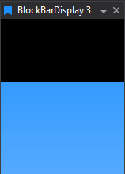

# Block Bar Display

Minimal single‑parameter bar for a quick, graphic visualization without numeric clutter. Optional gradient colour and conditional colouring using parameter warning/critical thresholds.

## Adding a Block Bar Display

To add a Block Bar Display to a Page do one of the following:

- Click the Block Bar Display button on the Display Toolbar.

- Click `File > New > Display` and select Block Bar Display.

- Press `Ctrl + Q` twice to use the Quick Access Assistant and select New Block Bar Display.

Drag a parameter onto the display to add it. The display shows one parameter. Double-click the bar to open its Parameter Properties, or right-click for the context menu.

## Display Properties

Press `D` with the display selected to open Display Properties.

| Property | Description | Default |
|---|---|---|
| **Display Orientation** | Show the bar horizontally or vertically | Vertical |
| **Use Gradient Colour** | Fills the bar with a gradient colour | On |
| **Use Conditional Colouring** | Colours the bar using the parameter's critical and warning limits, if they are enabled. When off, the parameter colour is used and the limits are ignored for colouring. | On |
| **Use Zero Value** | Starts the bar from **Zero Value** instead of the display minimum | Off |
| **Zero Value** | The starting point for the bar when **Use Zero Value** is on | 0 |
| **Background colour** | The display's background colour | |
| **Auto Refresh Rate (Hz)** | How often the display updates when data is panning automatically | 10 Hz |

Use **Use Zero Value** for values that swing either side of a centre point, such as a balance or an offset, so the bar grows up or down from that point.

## Spotting out-of-limit values

When **Show Critical Limits** or **Show Warning Limits** is on for the parameter, triangle markers show where those limits sit on the bar. With **Use Conditional Colouring** on, the bar colour also changes when the value goes outside its warning or critical limits.
