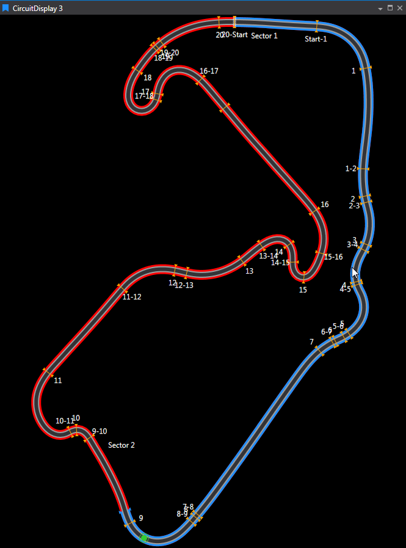
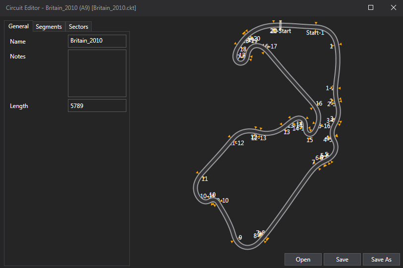

# Circuit Display

Track map from a Circuit Definition file, with cursor‑synchronised car position indicator and optional sectors/segments; a shaded Timebase Region on the map mirrors the Waveform timebase.

## Adding a Circuit Display

To add a Circuit Display to a Page do one of the following:
- Click the Circuit Display button  on the Display Toolbar.

- Click `File > New > Display` and select Circuit Display.

-  Press `Ctrl + Q` twice to use the Quick Access Assistant and select New Circuit Display.

You can now use the Parameter Browser to add some Parameters to set up the display as required. The current cursor position is shown on the circuit if you add the sLap Parameter.

## Choosing the circuit

By default, with **Global Circuit Definition** set to **Auto** in the options, the display picks the circuit automatically from the Circuit Location parameter or the session's Circuit property. If no circuit matches, the display shows a message explaining why. To pick a circuit yourself, turn off **Use Global Circuit Definition** in Display Properties and choose from the **Circuit** list. **Circuit File** and **Last Modified** show the path and date of the circuit in use.

The options for the display are in **Tools > Options > Plugins > Circuit Display**: **Circuits Location**, **Global Circuit Definition**, **Circuit Location Parameter Name**, **X-Axis Mapping**, **End of straight parameter**, and the parameters and settings used to generate circuits.

If the display shows a distance mapping message at the top left, click it to open the options and fix the mapping.

## Display Properties

Press `D` with the display selected to open Display Properties.

| Property | Description |
|---|---|
| **Use Global Circuit Definition** | Use the global circuit, or turn off to choose a circuit for this display |
| **Circuit** | The circuit shown when **Use Global Circuit Definition** is off |
| **Angle of Rotation** | Rotates the circuit, so you can match the orientation your team is used to |
| **Show Sectors** | Shows or hides the track sectors |
| **Show Segments** | Shows or hides the track segments (corners and straights) |
| **Show Colour Bar** and **Colour Bar** | Shows the colour bar legend and chooses which one to use |
| **Background Colour** | The display's background colour |
| **Auto Refresh Rate** | How often the display updates when data is panning automatically |

## Moving around the circuit

- Click or drag on the track to move the cursor to that point.
- Double-click the display to go back to following live data.

## Generating a circuit from data

If you do not have a circuit file, right-click the display and select **Auto generate circuit from current lap**, or press `Ctrl+Alt+T`. ATLAS builds a track map from the current lap. You cannot generate a circuit from a live lap, the last lap of a session, or an in, out or pit lap, because these would give a poor map. Pause live scrolling and select a completed lap first.

## Circuit Editor 

The Circuit Editor is a tool within ATLAS that allows users to create and modify Circuit Definition files. These files control how a racing track is visually represented and subdivided into Segments (Corners and Straights) and Sectors, ensuring consistency across displays such as Circuit Display and Waveform.

- **Segments**: Engineering-relevant divisions of the lap, typically representing corners (green) and straights (yellow).
- **Sectors**: User-defined partitions of the lap, often used for timing and analysis, with customizable colors.

### File Management

- Circuit definitions are stored in a user-configurable folder (set in Options ▸ Plugins).
- The Circuit Display’s dropdown menu is populated from files in this folder.
- Supported formats:
    - `.cktx`: ATLAS Circuit Definition (preferred; always written on save).
    - `.ckt`: Atlas 9 legacy format (can be opened and converted to `.cktx`).

### Using the Editor

You can open the Circuit Editor in two ways:
1. Via **Tools ▸ Circuit Editor**, then select a `.cktx` or `.ckt` file.
2. By right-clicking an existing Circuit Display and choosing **Edit**.

- **Save**: Writes the current definition in `.cktx` format. Legacy `.ckt` files are converted.
- **Save As**: Allows duplication under a new name, useful for creating event-specific variants.

The editor is organized into three tabs, each with a live preview:

1. **General Tab**
     - Set the circuit’s **Name**, add **Notes**, and specify the **Reference Length**.
     - Set the **Lap Trigger Offset** and the **Main Straight Start** and **Main Straight End**.
     - Preview shows the circuit as it will appear in displays.

2. **Segments Tab**
     - Define the sequence of corners and straights.
     - Add segments with **Insert Corner** or **Insert Straight**, rename or **Delete** them, and use **Auto Name** to name them automatically; adjust boundaries by dragging or entering values.
     - Use the **Show** column to choose which segment names appear.
     - Segments are color-coded and labeled for clarity.

3. **Sectors Tab**
     - Partition the lap for timing/analysis.
     - **Insert**, **Add**, rename, recolor, or **Delete** sectors; adjust boundaries interactively.
     - Use the **Show** column to choose which sector names appear.
     - Sectors are independent of segments.

## Workflows

- **Create Segments**: Open a circuit, switch to Segments, insert boundaries, set types and names, adjust distances, and save.
- **Define Sectors**: Switch to Sectors, insert splits, name and color sectors, adjust boundaries, and save.
- **Correct Mistakes**: Use Add/Delete without moving the cursor to revert changes.
- **Document**: Update the circuit’s name and notes for clarity and team standards.

!!! tip "Tips & Best Practices"
    - Keep segment/sector boundaries monotonic and within adjacent limits.
    - The Start/Finish line is fixed; plan boundaries accordingly.
    - Use **Save As** for alternate layouts to avoid overwriting base definitions.
    - Undo is limited; use Add→Delete cycles for safe reversion.

## Integration Checklist

- Ensure Circuit Display shows the correct circuit, segments, sectors, and orientation.
- Waveform pages should use the intended circuit definition and enable Circuit Stripe as needed.
- Confirm the Options ▸ Plugins folder points to the correct repository for shared access.