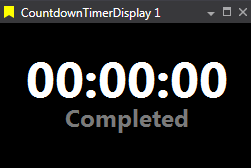

# Countdown Timer Display

A configurable countdown clock (or Time Offset from now) with custom text pre‑ and post‑expiry. Use it to count down to a session end or curfew, or to show the time in another time zone.

| Option         | Description                                                                                  |
|----------------|---------------------------------------------------------------------------------------------|
| **Timer Mode** | Choose between Countdown Timer (counts down to set time) or Time Offset (shows offset time).|
| **Expiry Hour** | Hour of expiry for the countdown timer.                                                    |
| **Expiry Minute** | Minute of expiry for the countdown timer.                                                |
| **Offset Hours** | Hours offset from current time for Time Offset mode.                                      |
| **Offset Minutes** | Minutes offset from current time for Time Offset mode.                                  |
| **Text Pre Expiry** | Text shown while the countdown is running.                                             |
| **Text After Expiry** | Text shown after the countdown has finished.                                         |

The timer is shown as `hh:mm:ss`. When the countdown finishes, the timer shows `00:00:00` and the description changes to **Text After Expiry**.

The **Text - Time** and **Text - Description** sections set the **Font Name**, **Font Size** and **Text Colour** for the timer and the description separately. **Background Colour** sets the display background.

## Adding a Countdown Timer Display

To add a Countdown Timer Display to a Page do one of the following:

- Click the Countdown Timer Display button  on the Display Toolbar.

- Click `File > New > Display` and select Countdown Timer Display.

- Press `Ctrl + Q` twice to use the Quick Access Assistant and select New Countdown Timer Display.