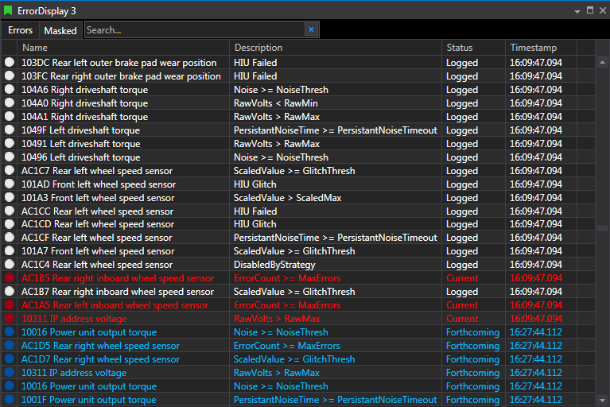

# Error Display

ECU errors during live connection. Columns include Status (Forthcoming/Current/Logged, with colours), Name, Description, Group, Timestamp. Double‑clicking an error jumps the timeline cursor to first occurrence. Logged errors persist until ECU reset based on your choice (per Lap or Session), which matches how the ECU itself clears its logged errors.

## Adding an Error Display

You can add an Error Display to a Page using any of the following methods:
- **Display Toolbar:** Click the Error Display button.
- **Menu:** Go to `File > New > Display` and select Error Display.
- **Quick Access Assistant:** Press `Ctrl + Q` twice, then select New Error Display.

## Error Row Details

Each error is displayed as a row with the following columns:

- **Status Indicator:**  
    A coloured symbol representing the error status:
    - *Forthcoming*: Error expected to occur later in the session (displayed in blue).
    - *Current*: Error is actively occurring (displayed in red).
    - *Logged*: Error occurred previously but is no longer active (displayed in white).

- **Name:**  
    Displays the error code and name.

- **Description:**  
    Provides a brief description of the error.

- **Group:**  
    The group the error belongs to.

- **Status:**  
    Indicates the error's relation to the session timeline:
    - *Forthcoming*: Will occur later in the session.
    - *Current*: Actively occurring error.
    - *Logged*: Previously occurred, now inactive.

- **Timestamp:**  
    Shows the time when the error was first detected.

## Error Status Behaviour

- When an error is detected, it appears with a red status indicator and a *Current* status.
- If the sensor returns to normal, the error switches to *Logged* status and a white status indicator.
- Logged errors remain visible and will revert to *Current* if the same error is detected again.
- Set **ECU resets logged errors on** in Display Properties to **Lap** or **Session** (default **Session**) to match when your ECU clears logged errors.

## Working with errors

- Double-click an error to move the cursor to its first occurrence.
- Type in the **Search...** box to show only matching errors. Press `Esc` to clear the search.
- Right-click selected errors and select **Mask Selected Errors** to move known errors to the **Masked** tab, so new errors stand out. On the **Masked** tab, select **Un-Mask Selected Errors** to bring them back.
- Right-click and select **Copy** (`Ctrl+C`) to copy the selected rows.
- Right-click and select **Error Filters** to choose which errors the display shows. When a filter is in use, the display shows an **Error Filter Applied** badge, and a **Synced to Global Error Filters** badge if it uses the global filters. Error filters can be exported to and imported from `.errxd` files to share them.

Display Properties also set the **Odd Row Colour** and **Even Row Colour**, **Show Grid**, **Grid Colour**, **Show Column Header**, **Font Name** and **Font Size**.
