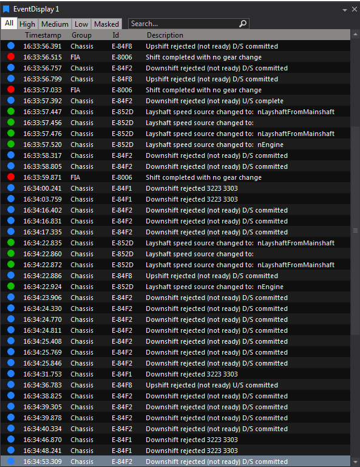

# Event Display

 ECU Events (from program version files defined in Options), with Priority (High/Medium/Low), Timestamp, Group, Id, Description, and parameter snapshots at the event time. Tabs allow quick filtering by priority or “Masked”. Clicking an event moves the timeline cursor to that time/distance.

 

## Adding an Event Display
- Use the Event Display button on the DisplayToolbar.

- Navigate to File > New > Display and select Event Display.

- Press Ctrl + Q twice to open the QuickAccess Assistant and select New Event Display.

**Event Display Overview**
Each event appears as a row with the following columns:
- **Priority Indicator**: Symbol showing event priority: red for High, blue for Medium, green for Low.
- **Timestamp**: Time when the event occurred.
- **Group**: Parameter group name related to the event.
- **Id**: Unique integer for diagnostics.
- **Description**: Text describing the event.
- **Parameter Name**: Value of selected parameters at event time. You can add up to 100 parameters.

**Filtering and Customization**
- Tabs at the top allow filtering by priority: All, High, Medium, Low, Masked.
- Column widths are adjustable (see "Columns in Displays").
- Click a column header to sort by that column. The sort order is remembered.
- Type in the **Search...** box to show only matching events. Press `Esc` to clear the search. **Include EventId** and **Include Group Name** add those columns to the search, and **Persist Search Text** saves the search with the workbook.
- Right-click and select **Event Filters** to choose which groups and events the display shows. When a filter is in use, the display shows an **Event Filter Applied** badge, and a **Synced to Global Event Filters** badge if it uses the global filters.
- Right-click selected events and select **Mask Selected Event Id(s)** or **Mask Selected Event Group(s)** to move known events to the **Masked** tab, so new events stand out. Use **Unmask Selected Event Id(s)** or **Unmask Selected Event Group(s)** to bring them back.

**Moving through events**
- Click an event to move the cursor to it. Press `Up` or `Down` to step through events; the cursor follows the selection.
- **Select Current Event When Panning** highlights the event at the cursor as you move through the data.
- Right-click and select **Copy** (`Ctrl+C`) to copy the selected rows.

**Display Options**
- By default, text uses the foreground colour.
- In **Row Visualisation - Priority Based**, turn on **Enable High Colouring**, **Enable Medium Colouring** or **Enable Low Colouring** to colour the row background by event priority, so high priority events stand out.
- Other options control the columns (**Show Priority Icons**, **Show Group Name**, **Show Event Id**, **Show Column Header**), the grid and the font.
