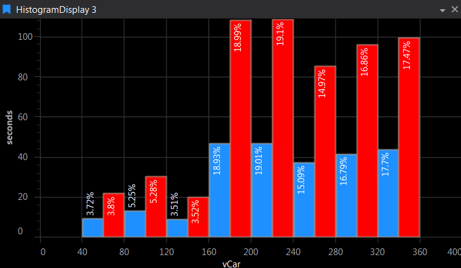

# Histogram Display

Distribution of a single parameter against time or distance, either Spectral (time/distance in each bin) or Cumulative (≤ each bin). X‑axis range comes from the parameter’s Display Min/Max. Optional % labels on bars and Y‑axis as % or absolute. Refresh per lap in Live Mode.

## Adding a Histogram Display

To add a Histogram Display to a Page do one of the following:

- Click the Histogram Display button  on the Display Toolbar.

- Click `File > New > Display` and select Histogram Display.

- Press `Ctrl + Q` twice to use the Quick Access Assistant and select New Histogram Display.

## Reading the Histogram

- **Spectral Mode** shows the time (or distance) spent in each bin. **Cumulative Mode** shows the running total up to each bin. Switch between them from the context menu or the **Mode** display property.
- Press `K` (**Cycle Through X-Axis Modes** in the context menu) to weight the bins by time or by distance. The context menu also lists each X-axis mapping so you can pick one directly.
- When several sessions are loaded, each session is drawn in its own colour so you can compare distributions.
- **Copy to Clipboard** in the context menu copies the bin edges and the percentage in each bin (one row per session) as tab-separated text, ready to paste into a spreadsheet.

## Display Properties

Press `D` to open Display Properties.

| Category | Property | What it helps with |
|---|---|---|
| General | **Background Colour** | Display background |
| Data | **Auto Refresh Rate (Hz)** | How often the display updates with live data |
| Data | **Refresh Per Lap (Live Mode)** | Refresh once per lap instead of continuously. Live Mode only. |
| Data | **Bins Count** | Number of bins, from 1 to 500 (default 10). An out-of-range value is rejected with a status bar message. |
| Data | **Mode** | Spectral or Cumulative |
| Appearance | **Label Format** | Label on each bar: None, Value, Percentage or All |
| Appearance | **Show Y-Axis as a Percentage** | Y-axis as a percentage, or in the current X-axis mapping (time or distance) |
| Appearance | **Auto-set Y-Axis Maximum Value** / **Y-Axis Maximum Value** | Fit the Y-axis to the largest bin, or fix it so comparisons stay fair |
| Axes | **Show X-Axis Label** / **Show Y-Axis Label** | Show or hide the axis titles |
| Axes | **Axis Font Size** | Font size of axis labels and values |
| Axes | **Show X-Axis Values** / **Show First and Last X-Axis Values** | Hide values when bins are too narrow to label |
| Axes | **Bins to Labels Ratio** | Label every bin (1), every other bin (2), and so on, to stop labels clashing |

The X-axis range and number format come from the parameter's **Display Maximum**, **Display Minimum** and **Format String** in Parameter Properties.
