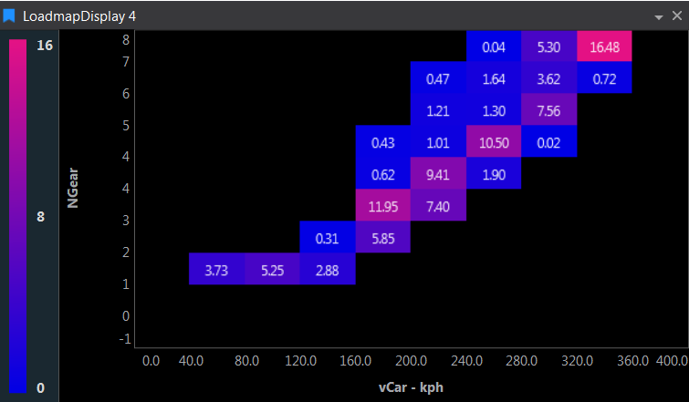

# Loadmap Display

Pseudo‑3D heatmap of time spent in ranges of one parameter vs. another (e.g., gear vs. speed). Grid squares show in‑range value to nearest 1%; bucket counts control resolution. Refresh per lap in Live Mode.

## Adding a Loadmap Display

To add a Loadmap Display to a Page do one of the following:

- Click the Loadmap Display button  on the Display Toolbar.

- Click `File > New > Display` and select Loadmap Display.

- Press `Ctrl + Q` twice to use the Quick Access Assistant and select New Loadmap Display.

## Display Properties

Press `D` to open Display Properties.

| Category | Property | What it helps with |
|---|---|---|
| General | **Background Colour** | Display background |
| Data | **Data Point Mode** | Fixed Frequency, Fixed Sample Count or All Samples |
| Data | **Frequency** / **Sample Count** | Sampling rate or number of samples used by the fixed modes |
| Data | **Refresh Per Lap** | Refresh once per lap instead of continuously. Live Mode only. |
| Data | **X Bucket Count** / **Y Bucket Count** | Number of buckets for each parameter (default 10). More buckets give a finer grid. |
| Appearance | **Placement** | Where the colour bar sits around the grid |
| Appearance | **Minimum Colour** / **Maximum Colour** | The two ends of the colour gradient |

The colour bar range is set automatically from the smallest and largest cell values.

For each parameter, **Display Maximum**, **Display Minimum**, **Format String** and **Show Units** in Parameter Properties set the bucket range and how values are labelled.

## Keyboard Shortcuts

| Key | Action |
|---|---|
| `D` | Display Properties |
| `Ctrl+Enter` | Parameter Properties for the selected parameter |
| `Delete` | Delete the selected parameter |
