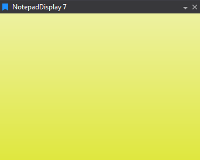

# Notepad Display

Free text notes for checklists and session details; useful to park instructions alongside data.

## Adding a Notepad Display

To add a Notepad Display to a Page do one of the following:

- Click the Notepad Display button  on the Display Toolbar.

- Click `File > New > Display` and select Notepad Display.

- Press `Ctrl + Q` twice to use the Quick Access Assistant and select New Notepad Display.

## Using the Notepad Display

The notepad display can be placed inside of another display's frame, in the legend area, or as a standalone display.

Type notes straight into the display. Text wraps to fit and can run over several lines. The notes are saved with the workbook.

A Snapshot of the Notepad can be saved to a text file.

1. Right click in the display.

2. Select **Snapshot to Data File**.

ATLAS writes the text to `Documents\McLaren Applied Technologies\ATLAS 10\Snapshots`. The status bar shows the full path of the file.

To copy text to the Clipboard, select it and press Ctrl + C.

While you type in the Notepad, these ATLAS shortcuts still work: `Page Up` and `Page Down`, `Ctrl+Q`, and `Ctrl` or `Shift` with `0` to `9` or `-`.

## Display Properties

Right-click the display and select **Display Properties**. You can set the **Font Name**, **Font Size** and **Text Colour**, the **Alignment Horizontal** and **Alignment Vertical** of the text area, its **Internal Padding**, and the **Background Colour**.
