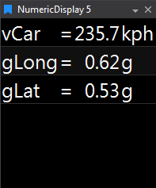

# Numeric Display

!!! abstract "At a Glance"
    **Parameters**: Up to 150  
    **Layout**: Auto-sizing grid  
    **Key Features**: Colour thresholds, hex formatting, status indicators  
    **Best For**: Dashboards, live monitoring, quick inspection

The Numeric Display shows instant numeric readouts for up to 150 parameters at the cursor position. Text auto-sizes to fit the display window, and colours can reflect warning/critical thresholds. Double-click a value to edit that parameter's properties.

## When to Use Numeric Display

:satellite: **Live monitoring**: Watch current values during recording

:bar_chart: **Dashboard creation**: Build custom parameter dashboards

:mag: **Quick inspection**: Check exact values at any cursor position

:traffic_light: **Status monitoring**: Use colour thresholds to highlight issues

:left_right_arrow: **Parameter comparison**: View multiple related parameters together

## Adding a Numeric Display

To add a Numeric Display to a page, choose one of the following methods:

- **Toolbar:** Click the **Numeric Display** button on the Display Toolbar.
- **Menu:** Go to **File > New > Display** and select **Numeric Display**.
- **Shortcut:** Press `Ctrl+Q` twice to open the Quick Access Assistant, type "Numeric", and select **New Numeric Display**.

Once added, use the **Parameter Browser** to add parameters and configure the display as needed.

## Display Anatomy

The Numeric Display shows a grid of parameters with:

- **Parameter name** (optional)
- **Current value** (at cursor position)
- **Units** (optional)
- **Colour highlighting** based on thresholds

Text size automatically adjusts to fit the available space.

## Key Features

### Auto-Sizing Layout

The display automatically:

- Calculates optimal text size based on window size
- Arranges parameters in a grid
- Adjusts when you resize the window
- Fills available space efficiently

You can override auto-sizing with fixed font size if preferred.

### Colour Thresholds

Parameters can show different colours based on their values:

!!! success "Normal"
    Default text colour (typically white)

!!! warning "Warning"
    Uses **Warning Colour** (default blue) when a value goes outside its warning limits

!!! danger "Critical"
    Uses **Critical Colour** (default red) when a value goes outside its critical limits

!!! note "Configuration"
    Set warning and critical limits for each parameter in the **Limits** section of the Parameter Properties panel, and turn on **Show Warning Limits** or **Show Critical Limits**. Parameters with these options off are never coloured.

### Flexible Formatting

Control what's displayed for each parameter:

- Show/hide parameter name
- Show/hide description
- Show/hide numeric value
- Show/hide units
- Show/hide a `+` sign on positive values (**Show Signs**), so the sign of a value is never ambiguous
- Show/hide status indicator

Parameters with a text conversion show the lookup text instead of the raw number. Parameters whose units are `ddmmyy.hhmm` are shown as a date and time.

### Status Indicators

Each indicator is a separate option in Display Properties, and all except **Show Status Indicator** are off by default:

- **Show Up Indicator**: arrow when the value is above the last displayed value
- **Show Down Indicator**: arrow when the value is below the last displayed value
- **Show Warning Indicator**: icon when the value is in its warning range
- **Show Critical Indicator**: icon when the value is in its critical range
- **Show Status Indicator**: sample status. `=` means the cursor is exactly on a sample, `?` means a default value. Between samples, the held value is shown with no indicator.

### Hex Formatting

For parameters displayed in hexadecimal:

- **Show "0x" for Hex Values** shows or hides the `0x` prefix (on by default)
- Configurable uppercase/lowercase
- Full hex formatting control

### Grid Overlay

Optional grid lines between parameters:

- Show/hide grid
- Custom grid colour
- Adjustable padding around items
- Column spacing control

## Display Properties

Press `D` with the display selected to open Display Properties.

### Text Formatting

**Font Name**: Choose from available system fonts (default Segoe UI)

**Font Size**:

- **Auto**: Automatically scales to fit window (recommended)
- **Use Fixed Font Size** with **Fixed Font Size**: Specify exact point size (default 12)

**Alignment - Text**:

- **Name** alignment (Left, Right)
- **Value** alignment (Left, Right)

**Displayed Items**:

- **Show Name**
- **Show Description** (off by default)
- **Show Value**
- **Show Units**
- **Show Signs** (off by default)
- **Show Status Indicator**
- **Show Up Indicator**, **Show Down Indicator**, **Show Warning Indicator**, **Show Critical Indicator** (off by default)
- **Show "0x" for Hex Values**

### Colour Options

**Colours - Text**:

- **Use Single Colour** with **Text Single Colour**: All parameters use the same text colour (on by default)
- Turn **Use Single Colour** off so each parameter uses its own colour

**Colours - Ranges (Critical and Warning)**:

- **Critical Colour** and **Warning Colour**
- **Apply Critical Colour** and **Apply Warning Colour**: Threshold colours affect text colour (on by default)

**Colours - Background**:

- **Background Colour**: Overall display background colour
- **Apply Critical and Warning Colours**: Threshold colours fill the row background, which is easier to see from a distance. Turn off **Apply Critical Colour** and **Apply Warning Colour** first.
- **Use Parameter Colour**: Fills each row background with the parameter colour

**Colours - Selected Items**:

- **Foreground** and **Background** for selected parameters
- **Use Parameter Foreground Colour**: Selected item text uses the parameter colour

**Note**: Critical/warning colours can apply to text OR background, not both simultaneously. The same applies to the parameter colour. If you try to use both, the status bar shows a message and the change is not applied.

### Grid and Layout

- **Show Grid**: Enable/disable grid lines between parameters
- **Grid Colour**: Colour of grid lines
- **Column Padding**: Space either side of the grid column lines
- **Item Padding**: Space around each parameter
- **Internal Border**: Padding inside the display area

### Data Update

- **Auto Refresh Rate (Hz)**: How often the display updates when data is panning automatically, for example in live. Choose 1, 2, 5, 10, 20 or 30 Hz (default 5 Hz).

## Adding Parameters

After creating a Numeric Display:

1. Open Parameter Browser (`P`)
2. Find the parameters you want to monitor
3. Drag parameters onto the display, or
4. Select parameters and Add to Display

You can add up to 150 parameters.

## Editing Parameter Properties

Double-click any parameter value to open its Parameter Properties panel where you can:

- Change parameter colour
- Set warning/critical thresholds
- Adjust decimal places
- Change display format (decimal, hex, scientific)
- Set custom units
- Enable/disable features per parameter

## Working with Parameters

### Selecting Parameters

- Click a parameter to select it
- Selected parameters show highlighted background
- `Ctrl+Click`: Add to selection
- `Shift+Click`: Select range

### Reordering Parameters

Drag parameters to reorder them within the grid.

### Removing Parameters

- Select parameter(s)
- Press `Delete` key

### Copying Values

**Copy to Clipboard**:

- Right-click > **Copy Selected Items to Clipboard** (or `Ctrl+C`) copies the selected parameters. If nothing is selected, `Ctrl+C` copies all of them.
- Right-click > **Copy to Clipboard** copies all parameters

Values are copied as tab-delimited text (name, value, units), suitable for pasting into Excel or other tools.

### Snapshot Export

Export current display values to file:

1. Right-click display
2. Select **Snapshot to Data File**

ATLAS writes a `.txt` file of comma-separated name, value and units to `Documents\McLaren Applied Technologies\ATLAS 10\Snapshots`, named after the display. The status bar shows the full path of the file.

## Keyboard Shortcuts

| Key | Action |
|-----|--------|
| `D` | Display Properties |
| `Delete` | Remove selected parameters |
| `Ctrl+C` | Copy selected values (all values if nothing is selected) |
| `Ctrl+A` | Select all parameters |
| `↑/↓` | Move the selection up or down |

## Example Configurations

=== "Dashboard Layout"
    Create a clean monitoring dashboard:
    
    - [x] Set **Show Name**: ON
    - [x] Set **Show Value**: ON
    - [x] Set **Show Units**: ON
    - [ ] Set **Show Description**: OFF
    - [x] Enable **Apply Critical Colour** and **Apply Warning Colour**
    - [x] Set appropriate thresholds
    
    :bar_chart: **Perfect for**: Live monitoring stations

=== "Minimal Value Display"
    Show just the numbers:
    
    - [ ] Set **Show Name**: OFF
    - [x] Set **Show Value**: ON
    - [ ] Set **Show Units**: OFF
    - [ ] Turn off **Use Single Colour** so each parameter uses its own colour
    - [ ] Disable **Show Status Indicator**
    - [ ] Hide grid for cleaner look
    
    :1234: **Perfect for**: Dense parameter grids

=== "Status Monitor"
    Highlight issues immediately:
    
    - [ ] Turn off **Apply Critical Colour** and **Apply Warning Colour**
    - [x] Enable **Apply Critical and Warning Colours** (Colours - Background)
    - [x] Set **Background Colour**: Dark colour
    - [x] Configure warning/critical thresholds
    - [x] Enable **Show Warning Indicator** and **Show Critical Indicator**
    - [ ] Leave **Use Fixed Font Size** off so text scales to fit
    
    :traffic_light: **Perfect for**: Alert dashboards

## Tips & Tricks

!!! tip "Layout Optimization"
    :white_check_mark: **Dashboard creation**: Use Numeric Display as main dashboard component
    
    :art: **Colour coding**: Set up threshold colours to instantly spot issues
    
    :arrows_counterclockwise: **Live monitoring**: **Auto Refresh Rate (Hz)** goes up to 30 Hz; the default is 5 Hz

!!! tip "Data Display"
    :1234: **Hex values**: Great for displaying status words and bit fields
    
    :mag: **Quick check**: Add Numeric Display temporarily to inspect specific values
    
    :desktop_computer: **Multi-monitor**: Float Numeric Display on second monitor for live monitoring
    
    :bookmark_tabs: **Parameter grouping**: Group related parameters for easier monitoring

## Troubleshooting

??? question "Text too small to read?"
    - Reduce number of parameters
    - Increase window size
    - Use fixed font size instead of auto

??? question "Text too large?"
    - Add more parameters to fill space
    - Use fixed font size and reduce point size

??? question "Colours not showing?"
    - Check warning/critical thresholds are configured in Parameter Properties
    - Verify **Show Critical Limits** or **Show Warning Limits** is on for the parameter
    - Verify **Apply Critical Colour** / **Apply Warning Colour** (text) or **Apply Critical and Warning Colours** (background) is enabled
    - Check text vs background colour application setting

??? question "Values not updating?"
    - Check **Auto Refresh Rate (Hz)** is appropriate
    - Verify session is loaded and active
    - Check cursor is moving (if not live)

??? question "Parameter disappeared?"
    May have been deleted instead of hidden. Re-add from Parameter Browser.
