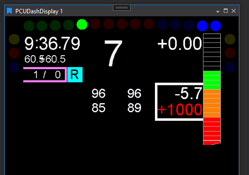

# PCU Dash Display

A simulator of the Motion Applied PCU Dash (as fitted to steering wheels). Supports multiple dash product types; auto‑loads a raw file if present (when the **Raw File** display property is set to **Auto**). Positioning/alignment controls help fit the simulator to the display window.

## Adding a PCU Dash Display

To add a PCU Dash Display to a Page do one of the following:

- Click the PCU Dash Display button  on the Display Toolbar.

- Click `File > New > Display` and select PCU Dash Display.

- Press `Ctrl + Q` twice to use the Quick Access Assistant and select New PCU Dash Display.

Until data arrives, the display shows **Waiting for session data...**. If some dash parameters have no matching parameter in the session, the status bar tells you how many could not be found.

## Display Properties

Press `D` with the display selected to open Display Properties.

| Property | Description |
|---|---|
| **Raw File** | The dash raw file to use. When set to **Auto**, ATLAS loads the raw file for the session each time a new session is loaded, recording starts or the display's set association changes, if it can find one |
| **Product Type** | Which type of PCU Dash to simulate |
| **Horizontal Alignment** and **Vertical Alignment** | Where the simulator sits when the display is wider or taller than the simulator |
| **Background Colour** | The display's background colour |
| **Auto Refresh Rate** | How often the display updates when data is panning automatically |

The display options, opened from the right-click menu, include **Raw Files Path**, **PCU8D LED Status Light parameter name**, **Auto map CAN parameters (by name)** and **CAN Bus Identifier**.

## Right-click menu

- **Copy MD5**: Copies the MD5 hash of the loaded dash configuration, so you can check the car is running the version you expect.
- **Refresh Raw Files**: Reloads the list of raw files, for example after copying a new file into the raw files folder.
