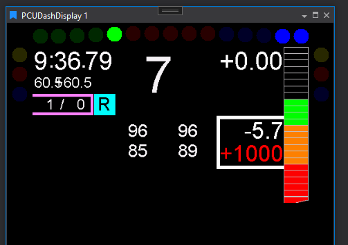

# PCU Dash Display

A simulator of the Motion Applied PCU Dash (as fitted to steering wheels). Supports multiple dash product types; auto‑loads a raw file if present (when the **Raw File** display property is set to **Auto**). Positioning/alignment controls help fit the simulator to the display window.



## Adding a PCU Dash Display

To add a PCU Dash Display to a Page do one of the following:

- Click the PCU Dash Display button  on the Display Toolbar.

- Click `File > New > Display` and select PCU Dash Display.

- Press `Ctrl + Q` twice to use the Quick Access Assistant and select New PCU Dash Display.

Until data arrives, the display shows **Waiting for session data...**. If some dash parameters have no matching parameter in the session, the status bar tells you how many could not be found.

## Display Properties

Press `D` with the display selected to open Display Properties.

| Property | Description |
|---|---|
| **Raw File** | The dash raw file to use. When set to **Auto**, ATLAS loads the raw file for the session each time a new session is loaded, recording starts or the display's set association changes, if it can find one |
| **Product Type** | Which type of PCU Dash to simulate |
| **Firmware Version**| The firmware version of the selected PCU Dash to simulate |
| **Horizontal Alignment** and **Vertical Alignment** | Where the simulator sits when the display is wider or taller than the simulator |
| **Background Colour** | The display's background colour |
| **Auto Refresh Rate** | How often the display updates when data is panning automatically |

The display options, opened from the right-click menu, include **Raw Files Path**, **PCU8D LED Status Light parameter name**, **Auto map CAN parameters (by name)** and **CAN Bus Identifier**.

## Right-click menu

- **Copy MD5**: Copies the MD5 hash of the loaded dash configuration, so you can check the car is running the version you expect.
- **Refresh Raw Files**: Reloads the list of raw files, for example after copying a new file into the raw files folder.

## Custom Firmware Configuration

This is a field found in `Tools > Options > Plugins > PCU Dash Display` where users can set an XML file in which they can specify any PCU Dash type and firmware version of their choice which can then be selected in the *ProductType* and *firmware version* dropdowns in the Display Properties window.
The XML file selected needs have a format like this:

```xml
<PcuDashInfos>
	<PcuDashInfo>
		<DisplayName>PCU8D</DisplayName>
		<FirmwareName>PCU8E.15x23.dll</FirmwareName>
		<RawFileExtension>.rawpcu8d</RawFileExtension>
		<DrawShiftLights>true</DrawShiftLights>
		<FirmwareDirectory>C:\FirmwareFolder</FirmwareDirectory>
	</PcuDashInfo>
	<ShellPcuDashInfo>
		<DisplayName>PCU700</DisplayName>
		<FirmwareName>PCU700.01x33.dll</FirmwareName>
		<CompanionShellName>PCU700.shell.dll</CompanionShellName>
		<RawFileExtension>.mldup</RawFileExtension>
		<DrawShiftLights>false</DrawShiftLights>
		<FirmwareDirectory>C:\FirmwareFolder</FirmwareDirectory>
	</ShellPcuDashInfo>
</PcuDashInfos>
```

The different parts of the XML are defined as follows:

- **PcuDashInfos** - The XML root which stores the collection of PCU Dashes to use
- **PcuDashInfo** - Each of these elements contain information for a specified PCU Dash version
- **ShellPcuDashInfo** - A PCU Dash version which requires a companion shell dll to draw the shift lights if *DrawShiftLights* is set to *false*
- **DisplayName** - The product type of PCU Dash display (e.g. PCU8D or PCU700) which are selectable options in the **Product Type** dropdown in the display properties window
- **FirmwareName** - The dll for the firmware version of the PCU Dash specified in *DisplayName*, which turns up as a selectable option in the **Firmware Version** dropdown. A value in this element must be suffixed with '.dll' and no two *PcuDashInfo* elements can have the same value for this **Firmware version**
- **CompanionShellName** - The companion shell dll for the firmware version of the PCU Dash specified in *FirmwareName* for a *ShellPcuDashInfo* entry, needed for drawing the shift lights if *DrawShiftLights* is set to *false*. Required to sit in the same directory as the dll specified in *FirmwareName* and also must be suffixed with '.dll' 
- **RawFileExtension** - The extension for the raw file type auto-loaded by the PCU Dash per product type
- **DrawShiftLights** - A boolean value specifying whether the PCU Dash needs shift lights drawn by ATLAS.
- **FirmwareDirectory** - The directory where the dll for the firmware version of the PCU Dash specified in *FirmwareName* is located as well as where the companion shell dll specified in *CompanionShellName* for a *ShellPcuDashInfo* entry.
