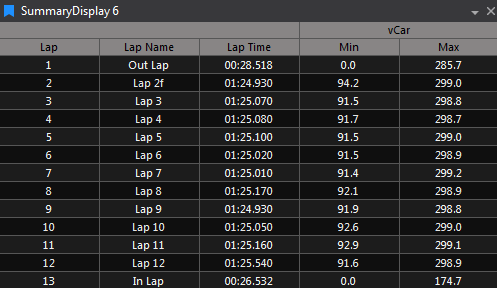

# Summary Display

Lap‑based statistics for selected parameters as a table or as a plot. First columns: Lap, Lap Name, Lap Time. For each parameter, you can add stats columns such as Min, Max, Mean, Start, End, End of straight, Change, Range, Absolute Mean, Geometric Mean, Std Dev, Slope, Slope Intercept, R².

## Adding a Summary Display

To add a Summary Display to a page, use one of the following methods:

- Click the **Summary Display** button on the Display Toolbar.

- Go to **File > New > Display** and select **Summary Display**.

- Press **Ctrl + Q** twice to open the Quick Access Assistant, then select **New Summary Display**.

Once added, use the **Parameter Browser** to choose parameters and configure the display as needed.

The first three columns are **Lap**, **Lap Name** and **Lap Time**. You can hide each one with **Show Lap Number**, **Show Lap Name** and **Show Lap Time** in Display Properties. For each parameter, you can display one or more statistics over the relevant data range. Available statistics include:

- **Min**: The minimum value recorded for the parameter within the lap.
- **Max**: The maximum value recorded for the parameter within the lap.
- **Mean**: The arithmetic average of all parameter values within the lap.
- **Start**: The parameter value at the beginning of the lap.
- **End**: The parameter value at the end of the lap.
- **End of straight**: The parameter's end-of-straight value for the lap, where one is available.
- **Change**: The difference between the end and start values of the parameter for the lap.
- **Range**: The difference between the maximum and minimum values for the parameter within the lap.
- **Absolute Mean**: The mean of the absolute values of the parameter within the lap.
- **Geometric Mean**: The geometric average of the parameter values within the lap.
- **Standard Deviation**: A measure of the variability or dispersion of the parameter values within the lap.
- **Slope**: The rate of change of the parameter values over the lap, calculated using linear regression.
- **Slope Intercept**: The intercept value from the linear regression of the parameter values over the lap.
- **Slope R Squared**: The coefficient of determination (R²) indicating how well the linear regression fits the parameter data within the lap.

You can resize columns individually, or right-click and select **Auto Resize Columns** to automatically adjust all column widths to fit the data.

To switch between table and plot views, right-click the display and select **Show as Plot** or **Show as DataGrid**.

## Choosing statistics

Click a parameter column header to open a menu where you can tick the statistics to show for that parameter, or open **Parameter Properties**. You can also set them with **Statistics to display** in Parameter Properties. Double-click a column header to open Parameter Properties directly.

Other parameter properties:

- **Weighted Statistics**: Weights each sample by how long it is held.
- **Show Shading** (**Shading** section): Shades the row backgrounds from **Primary Colour** (smallest value) to **Secondary Colour** (largest value), so you can see which laps stand out at a glance.

## Spotting out-of-limit values

In the table, cells outside a parameter's warning limits are coloured blue and cells outside its critical limits are coloured red. Turn on **Show Warning Limits** or **Show Critical Limits** for the parameter to use this.

In the plot, the **Plot Limits** properties control how limits are shown:

- **Show Warning Limit Lines** and **Show Critical Limit Lines** draw a horizontal dashed line at each limit.
- **Highlight Warning Points** and **Highlight Critical Points** circle points that are outside the limits. Set the circle with **Warning Highlight Colour**, **Warning Highlight Border Width**, **Warning Highlight Gap Width** and the matching critical properties.

These only apply to parameters with **Show Warning Limits** or **Show Critical Limits** on.

## Display Properties

Press `D` with the display selected to open Display Properties. Useful properties include:

| Property | Description |
|---|---|
| **Hide In/Out Laps** | Hides in and out laps so they do not skew the statistics: **Never**, **Plot**, **Grid** or **Always** |
| **New Lap Refresh Delay (secs)** | During live recording, how long to wait before data for the last full lap is requested again, so late data is included. 5 to 40 seconds |
| **Show as Plot** | Shows the table as a lap by lap line graph |
| **Share Y-Axis** | Uses one y-axis for all parameters instead of one per parameter. Set the range with **Auto Set Shared Y-Axis Display Range**, or **Shared Y-Axis Display Minimum** and **Shared Y-Axis Display Maximum** |
| **Show Legend** and **Legend Placement** | Shows a legend you can click to hide or show traces. Place it **Inside**, **Left**, **Right**, **Top** or **Bottom** |
| **Show Tooltip Mode** | When plot tooltips appear |
| **Use Fixed Lap Count (Live-mode only)** and **Fixed Lap Count** | Fixes the number of laps on the plot x-axis so the spacing between points does not change as the session goes on: **Never**, **Always** or **Live Only** |
| **Show Point Markers** and **Point Marker Size** | Shows a marker at each data point |

In the plot, double-click a point to move the cursor to where that value happened, for example the time of a lap maximum.

## Snapshots

Right-click the table and select **Snapshot to Data File** to save the table to a file, or **Copy to Clipboard** to copy it. The **Snapshot Generator** properties set the **Export Type**, **File Format**, **Snapshot Filename**, **Include Hidden Columns** and **Export Column Headers**. The folder is set by **Snapshots Directory** in **Tools > Options > Plugins > Summary Display**.

Turn on **Automatic Snapshots** to create a snapshot when the association, primary session, parameters or statistics change, and on each new lap in a live session.
