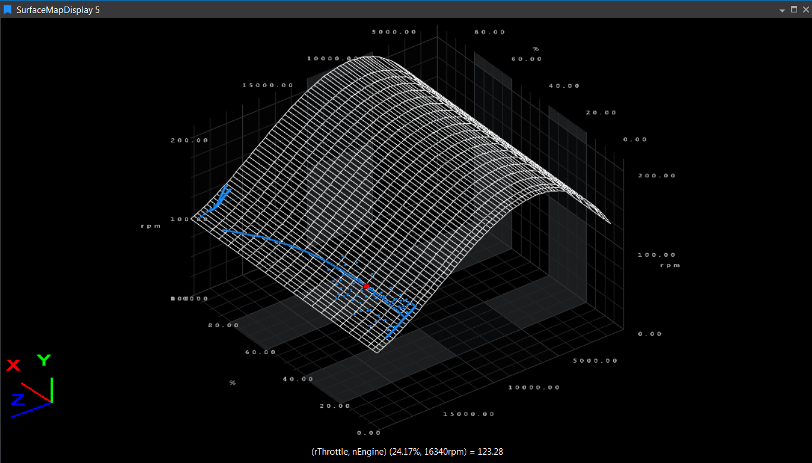

# Surface Map Display

The Surface Map Display provides an interactive 3D visualization using a `.3d` map definition. It pairs two parameters (such as throttle and engine speed) and interpolates a third value. The display shows the mesh from the `.3d` file, data points in the display set colour, and highlights the current cursor point. You can rotate the map with the mouse, zoom with the mouse wheel, and double‑click to reset the view.

## Adding a Surface Map Display

To add a Surface Map Display to a page, use one of the following methods:

- Click the **Surface Map Display** button on the Display Toolbar.
- Go to **File > New > Display** and select **Surface Map Display**.
- Press **Ctrl + Q** twice to open the Quick Access Assistant and select **New Surface Map Display**.

## Setting Up the Display

After adding the display, specify the location of the `.3d` file:

1. Press **D** to open the Display Properties tool window.
2. Enter the file location in the **Map Definition** option.

Next, use the **Parameter Browser** to add the two parameters for which the map file is configured.

## Display Features

- The map (grid and mesh) appears once parameters are set.
- The mesh (from the `.3d` file) is shown in white by default.
- Data points are drawn in the display set colour (blue in the example).
- The current cursor point is highlighted as an enlarged point (red by default).
- All display properties can be adjusted in the Display Properties tool window.

You can interact with the map by rotating it with the mouse, zooming in or out with the mouse wheel, and resetting its position by double-clicking the display.

## Display Properties

Press `D` to open Display Properties.

| Category | Property | What it helps with |
|---|---|---|
| General | **Background Colour** | Display background |
| Data | **Refresh Per Lap** | Refresh once per lap in Live Mode |
| Data | **Data Point Mode** | Fixed Frequency, Fixed Sample Count (default) or All Samples |
| Data | **Fixed Frequency Hertz** / **Fixed Sample Count** | Sampling rate or number of samples used by the fixed modes |
| Map | **Map Definition** | Path to the `.3d` file |
| Map | **Show Map Wireframe**, **Map Wireframe Colour**, **Map Wireframe Width** | Show the mesh and set its colour (white by default) and line width |
| Map | **Colour Map** and **Colouring Mode** | Colour the surface; Colouring Mode is Gradient, Textured or Textured Solid Cells |
| Map | **Map Opacity** | See data points through the surface |
| Map | **Show Map Point Tooltips** | Hover the surface to read X, Z and Y values with parameter names |
| Data Series | **Data Point Size** and **Show Data Point Tooltips** | Point size and hover values for the data points |
| Data Series | **Cursor Point Size** and **Cursor Point Colour** | Make the current operating point easy to spot |
| Axes | **Axis Labels** | Name, Units, Both or None |
| Axes | **Axis Font Size**, **Text Colour** | Axis text |
| Axes | **Show Major Gridlines**, **Show Minor Gridlines**, **Show Major Ticks**, **Show Minor Ticks**, **Show Background Bands** | Grid and tick detail |
| Axes | **Show Xyz Gizmo** | Show the orientation indicator |
| Axes | **Border Width**, **Border Colour** | Axis plane border |
| Label | **Label Font Size** | Label text size |
