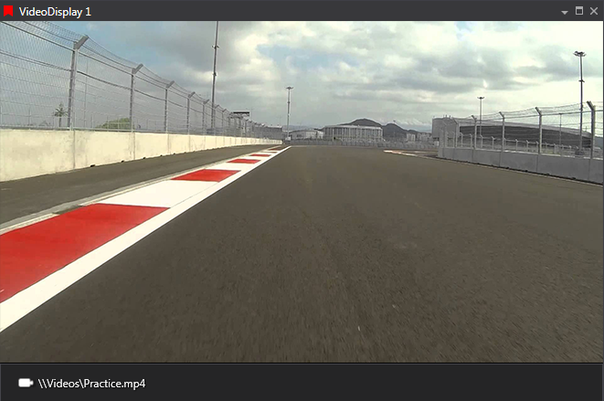

!!! danger "Preview Functionality"
    Video display is currently a preview feature. As such, the content in this page is subject to change based on feedback and roadmap changes.

# Video Display

Related video (e.g., in‑car camera) played alongside session data.

## Adding a Video Display

!!! note
    You must enable preview features in Tools > Options > General > Preview Features to use the Video Display. Tick **Allow New Video display (Restart Required before taking effect)** and restart ATLAS.

To add a Video Display to a page, use one of the following methods:

- **Display Toolbar:** Click the **Video Display** button.
- **Menu:** Go to **File > New > Display** and select **Video Display**.
- **Quick Access Assistant:** Press `Ctrl + Q` twice, then select **New Video Display**.

## Synchronising Video with a Session

To synchronise a video with session data, first click **Lock to timeline** on the video player. When the player is unlocked, the video and the data move independently.

- **Play Video:** Click **Play** on the video. The waveform cursor will automatically synchronise to the current video frame.
- **Navigate by Cursor:** If the video is not playing, move the waveform cursor. The video will display the frame corresponding to the timestamp under the cursor.

Only one video player drives the cursor at a time. When you play a locked video, any other video that was driving the cursor is paused.

If the video does not start at the same moment as the session, click **Set offset** and enter the offset in milliseconds in **Select the video offset (ms):** to line the video up with the data.

## Video controls

- **Open media file**: Choose a video file. You can also drag a video file onto the player.
- **Play**, **Pause** and **Stop**
- **Rewind one sec** and **Forward one sec**
- **Previous frame** and **Next frame**, for checking an exact moment frame by frame
- **Decrease speed**, **Increase speed** and **Normal speed**: Playback speed from 0 to 10 times normal speed
- **Mute**: Silences the video audio
- **Lock to timeline**: Keeps the video and the data cursor in step

The player shows the current position and the video length as `hh:mm:ss.fff`.

## Showing more than one video

Right-click the display and select **Add Video Player** to show another video in the same display, for example an onboard camera next to a pit camera. **Video Stack Orientation** in Display Properties sets whether the players are stacked vertically or horizontally.
