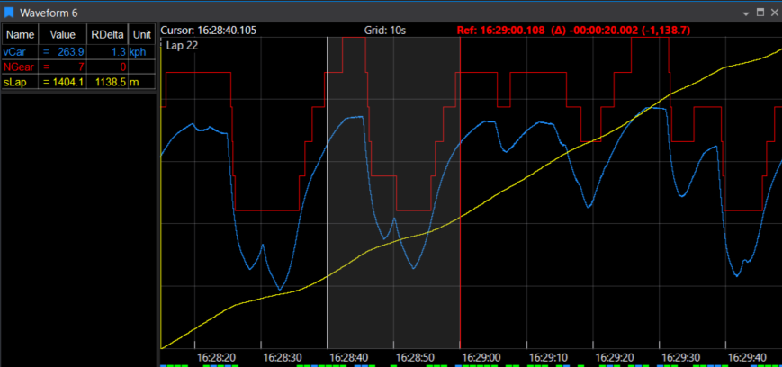

# Waveform Display

!!! abstract "At a Glance"
    **Parameters**: 100 by default (**Maximum Number of Parameters** in the Waveform options)  
    **X-Axis**: Time or Distance  
    **Key Features**: Multiple cursors, statistics, events, zoom  
    **Best For**: Time-series analysis, multi-session comparison

The Waveform Display plots multiple parameters as traces against time or distance. It's the most versatile display in ATLAS, supporting live telemetry and historical sessions, fast zooming, and rich formatting. Use it for:

- Braking/throttle application vs. speed, per corner or lap
- Multi-session comparisons with Time Difference (TDiff) in Distance mode
- Event-driven triage (ECU events/errors) aligned to timestamps or distances

## When to Use Waveform Display

:racing_car: **Driver analysis**: Brake/throttle application vs. speed per corner

:bar_chart: **Multi-session comparison**: Compare different laps or sessions side-by-side

:mag: **Event investigation**: See telemetry context around ECU events

:chart_with_upwards_trend: **Trend analysis**: Identify patterns over time or distance

:satellite: **Live monitoring**: Watch real-time telemetry streams

## Adding a Waveform Display

=== "Quick Access"
    Press `Ctrl+Q` twice, type "Waveform", press `Enter`
    
    :zap: **Fastest method**

=== "Toolbar"
    Click the Waveform icon on the Display Toolbar
    
    :mouse: **One click** when you know the icon

=== "Menu"
    **File** > **New** > **Display** > **Waveform Display**
    
    :books: **Browse all options**

### Parameter Selection

- Use Parameter Browser (default max 100 parameters, configurable)
- Double-click legend items for Parameter Properties (supports single/multi-session editing)

### Compare Sets

- Load multiple sessions into a set
- Switch sets: `Shift+<n>` (selected display), `Ctrl+<n>` (whole page), or click coloured tag on title bar

## Display Anatomy

### Plot Area

- One coloured trace per parameter
- Grid (vertical/horizontal/both) with adjustable spacing (shown at top of plot)
- Cursor line showing current position
- Cursor text at top-left (shows Time, and Distance in Distance mode)
- X-axis showing time or distance
- Event markers below X-axis (coloured squares)

### Legend

- One row per parameter with cursor value and statistics
- Colour bar matches trace colour
- Click rows to select parameters
- Reposition, resize, grid, show units, toggle headers
- Select rows (`Ctrl`/`Shift`) to highlight traces and perform actions (hide/delete/distribute)
- Drag rows up or down to reorder the legend
- Each session has a header with a colour stripe, a button to show or hide all of that session's parameters, and a toggle between **Use Parameter Colours** and **Use Session Colour**
- With **Show Warning Indicators** on, up and down arrows flag parameters outside their warning (blue) or critical (red) limits

**Reading the value column**: a `=` next to a value means it is a recorded sample, and `?` means a default value is shown. Use this to tell real data from filler before you quote a number.

### Axes

- **X-Axis**: Time (default) or Distance (press `K` to switch)
- **Y-Axis**: Per-parameter scales (enable in Parameter Properties)

## Key Features

### Cursors

**Cursor Modes** (View menu or shortcuts):

| Mode | Key | Description |
|------|-----|-------------|
| Value | `V` | Vertical line, shows sample values (default) |
| Crosshair | `C` | Adds horizontal sight line |
| Gradient | `G` | Diagonal line with three handles; legend shows per-signal gradient |
| Hide | `H` | Turn off cursor display |

The same modes are on **View > Cursor Mode** and the display toolbar. The **Cursor Mode** display property saves the choice with the display.

!!! tip "Reference Cursor"
    Press `R` (or **Use Reference Cursor** in the context menu) to add a red reference line for comparison.
    
    **Features:**
    
    - Red reference line; shaded window between reference and current cursor defines analysis range
    - Red `Ref:` text on the plot shows the reference position and the time or distance difference (Δ) to the cursor
    - The legend computes statistics for that window; the Delta column appears even when **Show Statistics** is off
    - Click or drag in the plot to move the cursor end of the window
    - Point at the red reference line until the pointer changes, then drag to move the reference end
    - Hold `Ctrl` and drag inside the window to move the whole window without changing its length

### Statistics

Enable statistics to see parameter behaviour over ranges:

!!! note "Setup Steps"
    1. Check **Show Statistics** in Display Properties (or press `S`)
    2. Choose your **Statistics Level**
    3. Toggle metrics with keyboard shortcuts

**Statistics Levels:**

| Level | Scope | Prefix |
|-------|-------|--------|
| Display | Visible timebase | D |
| Lap | Current lap only | L |
| Session | Entire session | S |
| Reference cursor | Window between the reference and current cursor | R |
| All | Ticks or clears a statistic at every level at once | n/a |

Reference Cursor can have its own level or swap with the chosen level (**Reference Cursor Uses** property: Own, Lap, Display or Session).

The keyboard shortcuts and context menu act on one level. Choose which in the Waveform options with **Context Menu and Key Shortcut Statistic Level**, and optionally **Override Context Menu and Key Shortcut Statistic Level for Reference Cursor**.

**Jump to a minimum or maximum**: click a Min or Max cell in the legend to move the cursor to the moment that value occurred.

**Available Metrics:**

| Metric | Key | Description |
|--------|-----|-------------|
| Min | `M` | Minimum value |
| Max | `X` | Maximum value |
| Mean | `N` | Average value |
| Delta | `E` | Difference between cursors |
| Std Dev | `Q` | Standard deviation |

!!! example "Reading Statistics"
    Statistics appear in legend with prefixes: **LMin** (Lap Min), **SMax** (Session Max), etc.

### Selecting, Highlighting, Hiding Parameters

**Select Parameters**:

- Click legend row to select one parameter
- `Ctrl+Click`: Add to selection
- `Shift+Click`: Select range
- `Ctrl+A`: Select all
- `Alt+Click` a trace in the plot to select it
- Click a Y axis to select the parameters on it; double-click it to open Parameter Properties
- Selected traces flash (by default)

**Hide Selected Parameters**:

- Hides traces but keeps legend entries
- Names shown with strikethrough
- Values shown in italics
- Unhide by selecting and pressing Hide again

**Delete Selected Parameters**:

- Removes parameters completely from display

**Distribute**:

- Stacks selected traces into separate bands
- Useful for avoiding overlapping traces
- **Reset Distribute**: Returns to normal view

**Autoscale**:

- Fits selected parameters to available vertical space
- **Reset Auto-Scale**: Returns to original scaling

### Events and Markers

**Event Indicators:**

!!! info "Event Colours"
    Coloured squares below X-axis indicate event severity:
    
    - :red_square: **Red**: High priority events
    - :blue_square: **Blue**: Medium priority events
    - :green_square: **Green**: Low priority events

**Features:**

- Hover for event details (time, ID, description and status); click a block to also move the cursor to the event
- Multiple events at same position show highest priority colour
- To mask events, hover over a block, tick the events in the popup and click **Mask Selected**
- To unmask, choose **View Masked Events** in the context menu, select events and click **UnMask Selected**
- Mask whole priorities with the **Mask: All**, **Mask: High**, **Mask: Medium** and **Mask: Low** display properties
- Events from the **Left to Right Overlay** lap are also shown

**Other Markers:**

| Marker Type | Description | Toggle |
|-------------|-------------|--------|
| Lap Markers | Vertical dashed lines at lap boundaries | Display Properties |
| Date Markers | Date shown with the time on the X-axis | Display Properties (**Show Date Markers**) |
| Clock or lap time | X-axis in time mode shows clock time or lap time | Display Properties (**Show Time As**) |
| Circuit Stripe | Track sectors/segments across top of plot; toggle labels; choose global/overridden Circuit Definition | Display Properties |

### Zoom and Navigation

**Zoom Box**:

- Right-drag, or hold `Shift` and left-drag, to create a zoom region (a plain left-drag moves the cursor). Press `Z` (or **Zoom Box** in the context menu) to arm a zoom box for the next left-drag.
    - Top-to-bottom: Zoom X and Y axes
    - Bottom-to-top: Zoom X-axis only (zoom strip)
- Press `Esc` to cancel a zoom box
- Mouse wheel, or `+` and `-`: Zoom X-axis (time/distance)
- `Ctrl+Z` undoes the last zoom and `Ctrl+Alt+Z` undoes all zooms (**Undo Zoom** and **Undo All Zooms** in the context menu)
- Toolbar zoom buttons

**Autoscroll** (Live Sessions):

- Middle mouse button (or both buttons)
- Pointer position controls scroll speed
- Click to exit autoscroll mode

**Pause/Inspect**:

- Single-click plot to pause scrolling and position cursor
- Double-click to resume scrolling

### Time vs. Distance Mode

Press `K` to cycle between X-axis mappings:

- **Time Mode**: X-axis shows elapsed time
- **Distance Mode**: X-axis shows distance travelled

**Time Difference (TDiff)** in Distance Mode:

- Plots time difference between sessions
- Shows which session is ahead/behind at each distance
- Enable **Show Time Diff** in Display Properties
- Choose TDiff start point (**Start** property in the Time difference category):
    - Start of lap
    - Cursor
- Press `F` (**Zero time difference** in the context menu) to reset the time difference to zero at the cursor

`Ctrl+K` applies the current X-axis mode to every display on the page, and `Ctrl+Shift+K` applies it to all displays, so traces stay aligned when you switch between time and distance.

### Sampling and Interpolation

**Sub-Sampling** (when multiple samples fall under a single pixel):

Set **Sample Mode** in Parameter Properties > Post Processing to choose how to display data:

- **First Value**: Show first sample value
- **Minimum**: Show minimum in range
- **Maximum**: Show maximum in range
- **Mean**: Show average
- **Minimum To Maximum**: Draw vertical line from min to max
- **Maximum To Minimum**: Draw vertical line from max to min

Legend shows min/max values; trace shows vertical min-max line.

**Interpolation**:

- Enable **Interpolate between samples** (Parameter Properties > Post Processing) to smooth traces and generate interpolated legend values
- Makes stepped traces appear smoother

### Session Comparison

**Show Differences**:

- Displays value difference between sessions at cursor
- Enable in Parameter Properties > Post Processing
- Pause live scrolling for readability
- Not available for:
    - Boolean or Text parameters
    - Functions
    - When using Filters or Trends

**Line up sessions by hand**: choose **Drag Session Offset** in the context menu, pick the session, then drag its traces left or right until features line up. Right-click to finish.

**Show or hide a compared session**: press `Ctrl+Shift+Alt+1` to `9` to toggle that session's traces without removing it.

### Left-to-Right Mode (Strip Chart)

For live telemetry analysis:

1. Enable **Draw left to right** in Display Properties
2. Traces overwrite from left as laps progress
3. Set **Gap %** to add gap ahead of cursor
4. Choose **Left to Right Overlay** lap for reference

Useful for comparing current lap against previous laps in real-time.

### Live Telemetry & Historical Replay

- **Live:** Waveform scrolls/updates if a live session is in the set
- **Historical Replay:** Enable **Allow Historic Replay**; double-click plot to replay
- A `Live` or `Live: Paused` label on the plot shows whether the display is following live data

## Keyboard Shortcuts

### Cursor Modes

| Key | Action |
|-----|--------|
| `V` | Value cursor mode |
| `C` | Crosshair cursor mode |
| `G` | Gradient cursor mode |
| `H` | Hide cursor |
| `R` | Toggle reference cursor |

### Statistics

| Key | Action |
|-----|--------|
| `S` | Toggle Show Statistics |
| `M` | Toggle Min statistic |
| `X` | Toggle Max statistic |
| `N` | Toggle Mean statistic |
| `E` | Toggle Delta statistic |
| `Q` | Toggle Std Dev statistic |

### Navigation

| Key | Action |
|-----|--------|
| `K` | Cycle X-axis mode (Time/Distance) |
| `Ctrl+K` / `Ctrl+Shift+K` | Apply X-axis mode to page / all displays |
| `D` | Display Properties |
| `←` / `→` | Move cursor to previous / next sample |
| `Home` | Cursor to start |
| `End` | Cursor to end |
| `F` | Zero time difference at cursor |
| `Z` / `Esc` | Zoom box / cancel zoom box |
| `+` / `-` | Zoom in / out |
| `Ctrl+Z` / `Ctrl+Alt+Z` | Undo zoom / undo all zooms |

### Parameters and Output

| Key | Action |
|-----|--------|
| `Ctrl+A` | Select all parameters |
| `T` | Hide or show selected parameters |
| `Delete` | Delete selected parameters |
| `Ctrl+C` | Copy selected legend items to clipboard (**Copy Legend Items to Clipboard** in the context menu copies every row) |
| `Ctrl+Shift+Alt+1` to `9` | Show or hide a compared session's traces |
| `Ctrl+P` / `Ctrl+Shift+P` | Print / Print Preview |

### Compare Sets

| Key | Action |
|-----|--------|
| `Shift+<n>` | Switch set (selected display) |
| `Ctrl+<n>` | Switch set (whole page) |

## Display Properties

Key properties you can configure:

### General

- Title
- Background Colour
- Show Title Bar

### Statistics

- Show Statistics
- Statistics Level (a grid of Min, Max, Mean, Delta and Standard Deviation for each level)
- Reference Cursor Uses

### Legend Settings

- Show Legend
- Position (Left, Right, Top or Bottom; default Left)
- Show Units
- Show Warning Indicators
- Value Alignment
- Show Grid
- Font Size
- Show Column Headers

### Waveform Settings

- Cursor Mode
- Cursor Minimum Precision (minimum decimal places in the cursor time)
- Highlight Mode (None, Highlight, Flash or Pulse) and Highlight Alpha (how much unselected traces dim)
- Align Grid to Y Scales
- Allow Historic Replay
- Show Grid (Normal, None, Horizontal Lines or Vertical Lines)
- Z-Order (Top To Bottom or Bottom To Top drawing order)
- Use Global Circuit Definition and Circuit Definition
- Draw left to right, Gap % and Left to Right Overlay (Previous Lap or Fastest Lap)
- Show Circuit Stripe (None, Sector or Segment) and Show Circuit Labels

### Markers

- Show Lap Markers
- Mask: All, Mask: High, Mask: Medium, Mask: Low
- Show Event Indicators
- Show Date Markers
- Show Time As (Clock Time or Lap Time)

### Time difference

- Show Time Diff
- Start (Start of lap or Cursor)

### Background Image

- Show Image, Image Left Offset, Image Top Offset, Image Path

Sub-sampling (**Sample Mode**), **Interpolate between samples** and **Weighted Statistics** are per-parameter settings in Parameter Properties > Post Processing, not display properties.

## Parameter Properties

Double-click a legend row or a Y axis to open Parameter Properties for that parameter. Waveform-specific settings include:

| Category | Property | What it helps with |
|----------|----------|--------------------|
| Trace | **Trace Width** | Line width from 1 to 10 pixels |
| Trace | **Trace Style** | Line, Small Point, Dot, Box, Cross, Line and Box, or Line and Cross, to see individual samples |
| Trace | **Line Style** | Solid, Dash Dash, Dot Dash or Dot Dot, to tell traces apart |
| Trace | **Y Scale** | Show the parameter's own Y scale |
| Trace | **Distribution Top** / **Distribution Bottom** | Set the band a trace occupies (you can also drag the handles on the plot) |
| Limits | **Display Maximum** / **Display Minimum** | Fix the Y range so the scale does not jump |
| Limits | **Clip Trace** | Hide trace drawn outside the display range |
| Limits | **Show Warning Limits** / **Show Critical Limits** | Draw dashed lines at the warning and critical limits |
| Limits | **Additional Markers** | Draw horizontal reference lines at the values you enter |
| Post Processing | **Filter Type** / **Filter Frequency** | Filter a noisy channel |
| Post Processing | **Trend** | Plot a per-lap statistic as a stepped trace |
| Post Processing | **Show Differences** | Plot the difference between compared sessions |
| Post Processing | **Weighted Statistics** | Use time-weighted statistics so irregular sampling does not skew the result |

## Example Configurations

=== "Driver Analysis"
    Analyse brake/throttle inputs:
    
    1. Add Waveform Display
    2. Add Brake, Throttle, Speed parameters
    3. Use **Distribute** to stack traces
    4. Switch to **Distance** mode (`K`)
    5. Add **Reference Cursor** (`R`) to compare corners
    
    :racing_car: **Perfect for**: Corner-by-corner driver analysis

=== "Multi-Session Comparison"
    Compare laps side-by-side:
    
    1. Load multiple sessions
    2. Switch to **Distance** mode (`K`)
    3. Enable **Show Time Diff**
    4. Use **Show Differences** for value deltas
    
    :bar_chart: **Perfect for**: Lap comparison and performance progression

=== "Live Monitoring"
    Real-time telemetry view:
    
    1. Connect live session
    2. Enable **Draw left to right** (strip chart mode)
    3. Set **Gap %** ahead of cursor
    4. Choose overlay lap for reference
    
    :satellite: **Perfect for**: Pit wall and live engineering

## Tips & Tricks

!!! tip "Parameter Management"
    :heavy_check_mark: **Too many parameters?** Use Distribute to stack traces vertically
    
    :mag_right: **Can't see parameter?** Use Autoscale to fit to screen

!!! tip "Analysis"
    :left_right_arrow: **Comparing laps?** Use Reference Cursor to compare two points
    
    :triangular_flag_on_post: **Analysing events?** Event markers show when things happened

!!! tip "Visualisation"
    :chart_with_upwards_trend: **Stepped signals?** Enable interpolation for smoother traces
    
    :mag: **Large dataset?** Zoom in to see detail, zoom out for overview
    
    :arrows_counterclockwise: **Multi-session comparison?** Use Time Diff in Distance mode
    
    :world_map: **Track context?** Enable Circuit Stripe to see where on track

## Troubleshooting

??? question "No Y-axis scales showing?"
    Enable per-parameter Y-Scale in Parameter Properties.

??? question "Traces overlapping and hard to read?"
    - Use Distribute function to stack traces into bands
    - Reduce number of visible parameters
    - Hide less important parameters temporarily
    - Use Autoscale to fit data to vertical space

??? question "Event markers not showing?"
    - Check **Show Event Indicators** is enabled in Display Properties
    - Check **View Masked Events** in the context menu for events you masked
    - Check the **Mask: All**, **Mask: High**, **Mask: Medium** and **Mask: Low** properties are off for the priorities you want to see

??? question "Differences not showing?"
    "Show Differences" not available with:
    
    - Filters, Trends, or Functions
    - Boolean/Text parameters
    - During live scrolling (pause to read values)

??? question "Cursor not moving?"
    - Click to focus the waveform display
    - Check keyboard focus is on the display

??? question "Stepped signals look wrong?"
    Consider enabling **Interpolate between samples** in Parameter Properties > Post Processing if interpolation is appropriate for the signal type.

??? question "Missing event markers?"
    Ensure **Show Event Indicators** is on; check Event Filters for masked priorities.
