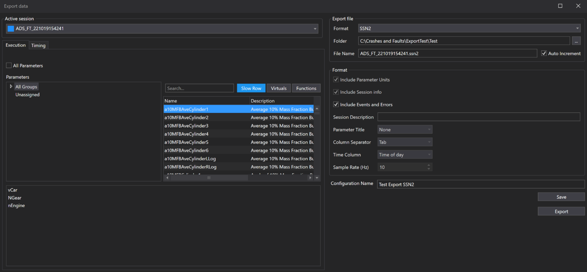
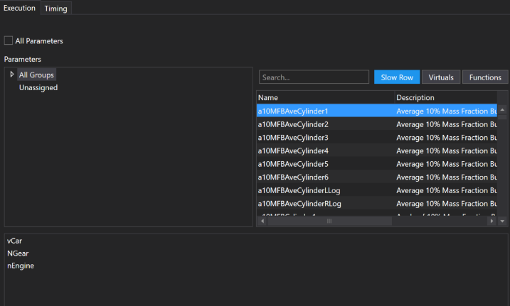
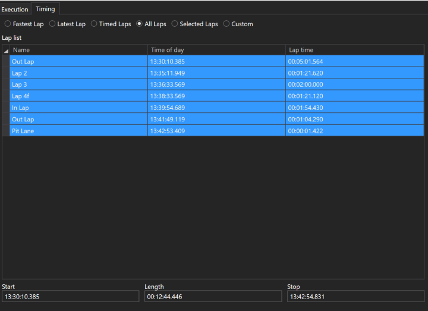
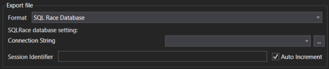
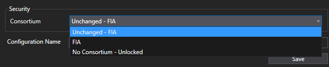

# Export Manager

The Export Manager helps you extract and save session data for analysis, reporting, or sharing. Use it to customize what data you export, how it's formatted, and where it's saved.

## Why Use the Export Manager?

- **Flexible Data Export:** Choose exactly which session data and parameters you need.
- **Multiple Formats:** Export to Text, Matlab, SSN2, or SQL Race Database.
- **Reusable Configurations:** Save export settings for future use.
- **Efficient Workflow:** Export directly from the Export Manager or the Export Data dialog.

## How to Use the Export Manager

Open the Export Manager from **Tools > Export Data** or press `Ctrl + E`. The Export Manager needs the **CSV/ASCII Export** licence option.

The Export Manager lists your saved configurations with their **Name**, **Format**, **Laps**, **Status** and **Consortium Name**. Select a configuration and press `Enter` to edit it or `Delete` to delete it, or right-click it for **Export**, **Edit** and **Delete**. Press `Esc` to close the Export Manager.

1. **Open Export Data Dialog:**  
    Click **New Config** to create a new Export Configuration.

2. **Select Session:**  
    Pick the session to export from the **Active session** drop-down list. Only sessions loaded via the Session Browser are available.

3. **Choose Parameters (Execution Tab):**  
    - Select specific parameters or use the **All Parameters** checkbox.
    - Filter by application group, channel type, or search by name.
    - Selected parameters appear in a list below.

    

4. **Set Timing (Timing Tab):**  
    - Choose laps to export or specify a custom time range.
    - Note: Custom time ranges work for text and Matlab exports. For composite sessions, only the first session is exported.

    

5. **Select Export Format:**  
    - Pick your desired format: **Text**, **Matlab 1D**, **Matlab 2D**, **SSN2** or **SQL Race Database**.
    - Format-specific options are enabled as needed. For example, **Include Parameter Units**, **Include Session info**, **Parameter Title** and **Column Separator** are enabled for Text exports, and **Include Events and Errors** is enabled for SSN2 and SQL Race Database exports.

6. **Configure Destination:**  
    - For SQL Race Database, select from available databases or add new connections via the Database Connection Manager, then set the **Session Identifier** (defaults to the selected session name).
    - For other formats, specify the file path.

7. **Auto Increment:**  
    - All export types support automatic version numbering to the file name or session identifier for SQL Race. When enabled and an export with that name already exists, the system appends `_1`, and increments the number for subsequent duplicates. 

    

8. **Save and Export:**  
    - Enter a **Configuration Name** and click **Save** to keep the configuration for future use.
    - Click "Export" to run the export immediately. Progress is shown next to the Export button.

Use the Export Manager to streamline your data export process and ensure you get the data you need, in the format you want.

### Removing Team Security

As of version 11.4.4.371, Export Manager now allows users to remove team security during export. This enables sharing sessions with trusted external parties (e.g., suppliers) using a generic ATLAS license.

!!! info
    - Consortium selection only affects who can open the exported session. As a member of the original consortium, you can choose how data is restricted during export.
    - The exported session will only include parameters you have access to under your current license.
    - RDA restrictions always remain applied, regardless of consortium changes or the **No Consortium - Unlocked** selection.
    - This feature is only available when exporting to SQLRace or SSN2 formats.

**How to Remove Team Security During Export:**

1. Open Export Manager and create a new export configuration.
2. Select the session(s) you want to export.
3. Choose the export format: SSN2 or SQLRace.
4. Select consortium restriction options:
    - Unchanged: Keeps the current consortium setting from the selected session. This option will change based on the session chosen.
    - No Consortium - Unlocked: Removes all team restrictions. The exported session can be opened by any ATLAS license.
    - Specific Consortium: Locks the export configuration to one consortium only, even if you later change the session.
5. Confirm export options:
    - If “All Parameters” is selected, RDA-locked parameters will not be exported.
6. Click Export or Save.
