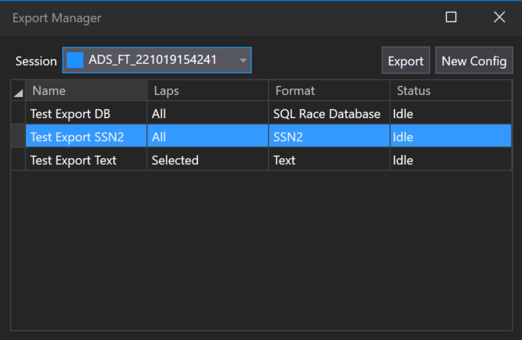

# Overview

You can export sessions in multiple ways to suit your workflow.

To export an entire session directly from SQL Race to an SSN2 file, right-click the session in the Session Browser and select **Export Session**. Make sure the session is not currently loaded into a Set before exporting. This option is not available for live sessions, `.ssn` or `.ssn2` files, or RTA sessions.

For more control, such as exporting specific parameters, laps, or using formats other than SSN2, use the [**Export Manager**](export-manager.md). Open it from **Tools > Export Data** or press `Ctrl + E`.

The Export Manager lets you create and manage export configurations (see example below). To export, select the desired session from the **Active session** dropdown (showing sessions loaded via the Session Browser), choose an export configuration, and click **Export**. The **Status** field will display progress as a percentage and update to **Done** when the export is complete.

## Sharing your ATLAS configuration

To copy your ATLAS settings to another PC or share them with a colleague, use a configuration bundle (`.acgx` file). Open **Tools > Import/Export Configuration**.

**To export your configuration:**

1. Select the **Export Current Configuration** tab.
2. Click **Refresh current configuration**.
3. Enter a **Profile Name**.
4. Under **Source files included in export**, select the files to include: **Functions**, **Constants**, **Circuits**, **PCU8D Raw Files**, **Bit Configuration File** and **Alarms**.
5. In the settings tree, select the settings to include.
6. Click **Export**.

**To import a configuration bundle:**

1. Select the **Import ATLAS 10 Configuration Bundle** tab.
2. Under **Select ATLAS 10 Configuration Bundle**, click **...** and choose the `.acgx` file.
3. Select the **Profile To Import**.
4. Under **Files Included in Bundle**, select the files to import.
5. Set **Source File Action** to **Ignore files with the same name** or **Overwrite files with the same name**.
6. Select the settings to import, then click **Import**.
