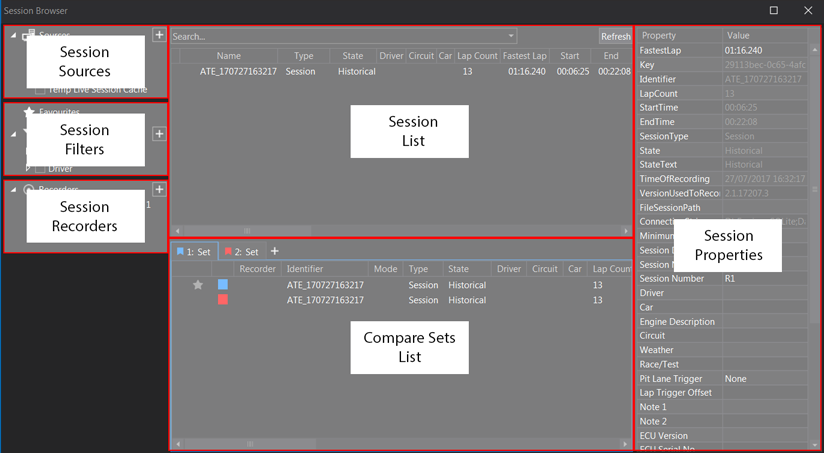

# Navigating the Session Browser

## Purpose of the Session Browser

The Session Browser is the primary interface in ATLAS for managing telemetry data Sessions. It allows users to:

- Load previously recorded (Historical) Sessions
- Record new (Live) Sessions
- Configure and manage data Recorders
- Combine multiple Sessions into Composite Sessions
- Group Sessions into Compare Sets for analysis
- View and edit Session metadata
- Connect to various data sources (e.g. databases, folders, services)

This tool is essential for any user working with telemetry data in ATLAS, whether for real-time monitoring or post-session analysis.

## How to Open the Session Browser

You can open the Session Browser in one of the following ways:

**Toolbar Icon** 

Click the Session Browser icon on the ATLAS toolbar.

**Menu Bar**

Navigate to `View > Session Browser`.

**Keyboard Shortcut**

Press `Ctrl + L` on your keyboard.

Once opened, the Session Browser will appear within the ATLAS interface. Press `F5` in the Session Browser to refresh it.

### Session Browser options

To change how the Session Browser refreshes and how many items it shows, go to **Tools > Options > Plugins > Session Browser**:

| Option | What it does |
|---|---|
| **Should Auto-Refresh** | Refreshes the Session Browser automatically. Off by default. |
| **Auto-refresh Interval (seconds)** | How often the automatic refresh runs. Default 300 seconds. |
| **Filters Display Limit** | Maximum number of values listed under each filter. Default 100. |
| **Session Query Result Limit (Sessions)** | Maximum number of Sessions returned by a query. |

## Layout of the Session Browser

The Session Browser is divided into six main panels, each serving a specific function:

### 1. Session Sources
This panel allows you to define where ATLAS should look for Sessions. Supported sources include:

- Folders on your local machine or network
- SQL Race databases
- RTA service connections (requires an RTA licence)

To add a new source:

1. Click the **Add Data Source** button or right-click the Sources panel.
2. Choose one of the following:
    - **Connection Manager...**: For SQL Race databases
    - **Folder Manager...**: For local or network folders
    - **Service Connections...**: For RTA hosts

Once added, ATLAS will index the source and display available Sessions in the Session List.

### 2. Session Filters
Filters help you narrow down the Sessions displayed in the Session List. By default, filters include:

- Circuit
- Driver
- Run Type

You can customise filters by:

1. Right-clicking the Filters title to see all available categories
2. Selecting or deselecting filter options
3. Saving the current filter combination as a preset for quick reuse

To save a filter preset, click **Save current filters as a preset** or right-click a filter group and select **Save Current Filters As Preset**. Enter a new name, or select an existing name to overwrite it, and click **Save**. Presets are listed under **Saved Filters**, where you can right-click a preset to **Rename** or **Delete...** it.

The filter group right-click menu also has **Collapse All** and **Clear All**.

### 3. Session Recorders

This panel is used to configure and manage data Recorders for capturing live telemetry. Supported Recorder types include:

- Data Server Telemetry
- Ethernet Telemetry
- File Telemetry
- Ethernet Multi-Session Offload
- Ethernet Offload
- TCP Listener Recorder
- NASCAR Telemetry Recorder (requires NASCAR licence)
- Stream Recorder
- USB Logger Recorder

Some Recorder types only appear when your licence includes them.

To control a Recorder, use its **Auto record**, **Start** and **Stop** buttons, or right-click it for **Edit...**, **Auto Record**, **Start**, **Stop** and **Delete...**. You can also select a Recorder and press `F2` to edit it or `Delete` to remove it.

**Recorder Modes**

When adding a Recorder to a Set, you can define its behaviour:

- Create: Each new recording creates a new Session.
- Replace: Each new recording replaces the previous Session in the Set.
- Append: New recordings are appended to existing Sessions, forming a Composite Session.

!!! note
    Starting a Recorder does not automatically load the Session into a Set. You must manually add it using the Session List or drag the Recorder into a Set.

### 4. Session List

This panel displays all Sessions available from the selected source. Each entry includes metadata such as:

- Session type (Historical or Live)
- State
- Driver
- Circuit
- Number of laps

You can:

- Search for Sessions using the search box
- Right-click to add Sessions to new or existing Sets
- Drag Sessions into Sets or onto other Sessions to create Composite Sessions
- Select multiple Sessions using `Shift + Click` or `Ctrl + Click`
- Click **Refresh** to reload the list
- Clear **Load Associate Sessions** if you do not want associated Sessions loaded with the Sessions you select (it is selected by default)

To load the selected Sessions from the keyboard or mouse:

| Action | Result |
|---|---|
| `Enter` or double-click | Adds the Sessions to the current Set |
| `Ctrl + Enter` or `Ctrl` + double-click | Adds the Sessions to a new Set |
| `Shift + Enter` or `Shift` + double-click | Replaces the Sessions in the current Set |

**Pinning Sessions**

Right-click a Session and select **Pin Session** to keep it at the top of the Session List. Select **Un-pin Session** to remove the pin.

**Exporting a Session**

Right-click a Session and select **Export Session** to export it to an SSN2 file. This option is not available for live Sessions, Sessions that are loaded in a Set, `.ssn` or `.ssn2` files, or RTA Sessions.

### 5. Compare Sets List

Also known as the Set List, this panel shows which Sessions and Recorders are currently loaded into each Set. 

Features include:

- Viewing Sessions within each Set
- Expanding Composite Sessions to see individual components
- Removing Sessions from Sets
- Customising columns (changes apply to both this panel and the Session List)

The active Set is highlighted with a coloured outline.

**Working with Set tabs**

- Press `Ctrl + N` to add a new Set, or click the new tab button (tooltip **Add New Set**). When the tooltip reads **Sets Limit Reached**, you cannot add more Sets.
- Right-click a Set tab and select **Rename** to rename it.
- Press `Ctrl + F4` to delete the selected Set, or right-click its tab and select **Delete**.
- Right-click a Set tab and select **Delete All Empty Sets** or **Delete All Sessions and Sets** to tidy up.

**Working with Sessions in a Set**

- Click the colour square next to a Session to hide or show that Session in Displays. The primary Session cannot be hidden.
- Right-click the colour square to pick a different colour for the Session.
- Click the mode icon of a Composite Session to switch between **Append Mode** and **Overlay Mode**.
- Right-click a Session for these options:
    - **Remove Session**
    - **Remove Recorder**
    - **Remove Session and Recorder**
    - **Promote to Primary**: makes this Session the primary Session of the Set
    - **Copy Session in Current Set**
- Select a Session and press `Delete` or `Backspace` to remove it from the Set.

### 6. [Session Properties](properties.md)

This panel displays detailed metadata for the selected Session. Properties are colour-coded:

- White fields: Editable
- Grey fields: Read-only

Editable properties include:

- Session Name and Number
- Driver, Car, Engine, Circuit
- Weather, Notes, and other descriptive fields
- Lap Trigger Offset (used to align data across Sessions)