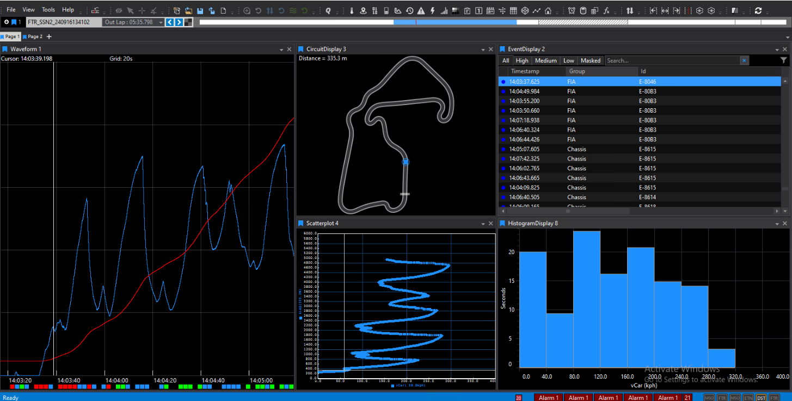
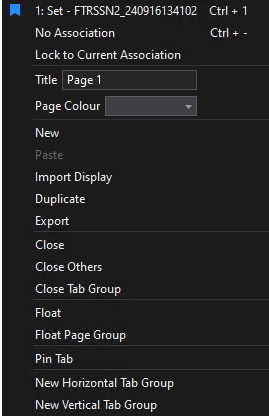
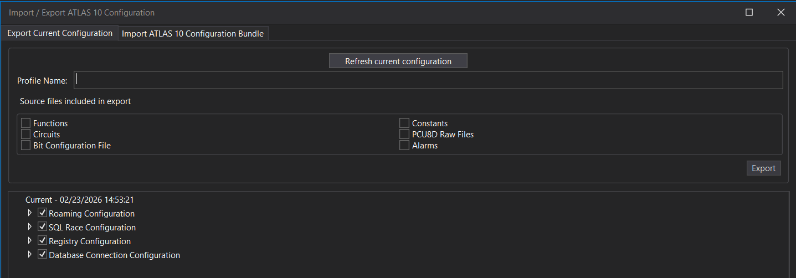
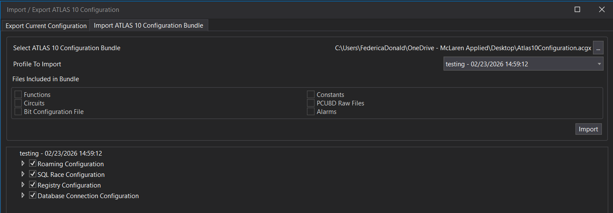

# Workbooks and Pages

Workbooks in ATLAS define your workspace layout and the arrangement of elements on the screen. Every ATLAS session contains at least one Workbook, which can hold multiple Pages, and each Page can display several [Displays](../displays/index.md).

## Saving and Opening Workbooks

- **Save your workspace:** Workbooks are saved as `.wbkx` files, preserving the formatting, size, and position of each Display and Page.
- **Open existing workspaces:** Use the File menu to open a Workbook. This replaces your current workspace. If you have unsaved changes, ATLAS will prompt you before proceeding.
- **Save As:** To rename a Workbook, use the Save As command. The default name is assigned when first opened (e.g., Workbook1).
- **Reopen recent work:** File > Recent Workbooks lists the Workbooks you used last. Set the list length with **Recent Workbook Max Count** in [Options](options.md) (default 15).
- **Open on start:** Enable **Open Last Workbook when Starting Atlas** and **Load Sessions with Workbooks** in [Options](options.md) to return to your last Workbook and its sessions when ATLAS starts.

Keyboard shortcuts: ++ctrl+o++ opens, ++ctrl+s++ saves and ++ctrl+alt+s++ saves as.

!!! note
    Compare Sets, Session data, Bit Config Files, Functions files, Alarm Files, Circuit Display Definitions, SurfaceMap Display Definitions, and PCU Dash Display RAW CAN files are not stored in `.wbkx` files but are automatically opened by the Workbook. If these files are missing, Displays will be empty.

### Workbook backups

When **Workbook Backups Enabled** is on in [Options](options.md) (the default), ATLAS copies the previously saved file into the **Workbook Backups Folder** each time you save a Workbook. Each backup goes in a time-stamped folder under the Workbook's name, and ATLAS keeps the number set by **Number of backups to keep per workbook** (default 5), deleting the oldest. The status bar shows "saved and backed up" when a backup was made.

To go back to an earlier version, copy the backup file out of the backups folder and open the copy. ATLAS does not open Workbooks from inside the backups folder, and you should not edit that folder by hand.

If ATLAS has to close after an unexpected error, it asks whether to save the current Workbook and, when backups are enabled, shows where the backups are.

!!! note
    ATLAS does not save Workbooks automatically on a timer in this release. Save your work regularly.

## Working with Pages

- **Default setup:** When ATLAS starts or a new Workbook is opened, it includes one Page.
- **Multiple Pages:** You can add, float, and arrange multiple Pages within a Workbook. Only one Page is selected at a time, but you can view several by floating them.
- **Page Bar:** Located at the top of the Main Window, it displays tabs for each Page. Use horizontal scroll arrows if tabs exceed available space.

### Page Management Options

Right-clicking a Page tab opens a menu with options to:

- **Set:** Switch or remove Compare Sets associated with the Page.
- **No Association:** Remove the current Compare Set link.
- **Lock to Current Association:** Lock the Page to its current Compare Set.
- **Title:** Edit the Page name.
- **Page Colour:** Underline the tab with a chosen colour.
- **New:** Add a new Page.
- **Paste/Import Display:** Add copied or saved Displays.
- **Duplicate:** Copy the Page and its Displays.
- **Export:** Save the Page for use in other Workbooks.
- **Close/Close Others/Close Tab Group:** Manage Page tabs.
- **Float/Float Page Group:** Move Pages into separate windows.
- **Pin Tab:** Toggle pin status.
- **New Horizontal/Vertical Tab Group:** Organize tabs in groups.

## Selecting Pages

- Click the desired tab on the Page Bar.
- Or, press **Page Up** or **Page Down**.

## Adding Pages

To add a new Page:

- Select **New** from the File menu, then **Page**.
- Click the **+** on the Page Bar.
- Click the **Add New Page** icon on the Main Toolbar.
- Right-click a Page tab and choose **New**.
- Press **Ctrl + N**.
- Press **Ctrl + Q**, then select **New Page**. If Quick Access opens in **Add New Parameter** mode, press **Ctrl + Q** again to show the actions.

New Pages are named sequentially (e.g., Page 2, Page 3). A new Page uses the same Compare Set as the rest of the Workbook where it can.

## Closing Pages

To close a Page:

- Click the **X** next to the Page name on the Page Bar.
- Or, right-click the Page Bar and select **Close**.

If the Page has Displays and the Workbook has unsaved changes, ATLAS asks you to confirm. **Close Others** always asks first. You cannot close the last Page in the Workbook.

## Page Colours

Colour code Page tabs by purpose, for example tyres, engine or brakes. Right-click a Page tab, choose **Page Colour**, and pick a colour.

## Page Groups

A Page Group is a separate floating window of Pages, useful for a second monitor.

- **Create a Page Group:** Select File > New > Page Group. ATLAS asks you to confirm, then duplicates all Pages from the primary window into the new Page Group.
- **Float a Page Group:** Right-click a Page tab and choose **Float Page Group**.
- **Find your Page Groups:** Use View > Page Groups.
- **Change the set for a whole Page Group:** Press ++ctrl+shift++ with a set key, for example ++ctrl+shift+2++ for set 2. See [Keyboard Shortcuts](keyboard.md#associating-compare-sets).

## Sharing a Session Reference

A Session Reference lets another engineer load the same session you are looking at.

1. Select File > Copy Session Reference (++ctrl+shift+c++). Choose a set that has sessions. ATLAS copies a reference to the primary session in that set to the clipboard.
2. Send the copied text to your colleague.
3. Your colleague copies the text, then selects File > Load Session Reference (++ctrl+shift+l++) and chooses a destination set.

!!! warning
    Loading a Session Reference overwrites the existing sessions in the destination set.

## Status Bar

The Status Bar appears at the bottom of the ATLAS Main Window and provides real-time feedback on system activity:

- **Last Action:** Displays a brief description of the most recent significant event, such as "Recording started" or error notifications. The bar colour shows the type of message: blue for normal, dark blue while busy, orange for a warning and red for an error. After a few seconds the bar returns to blue and shows "Ready".
- **Recorder Status:** Shows a symbol for each connected recorder, with initials indicating the recorder type. The border colour shows its state: green when idle with a good link, orange when idle without a link confirmed, grey when monitoring, and red while recording. The link colours only show while the recorder is idle. Double-click a recorder to edit it, or right-click it for **Edit**, **Auto Record**, **Start** or **Stop**, and **Delete**.

- **Error Count:** A red badge shows the number of error and warning messages. Hover over it to see the messages; right-click and select **Clear** to remove them.
- **Alarms Warnings:** Shows the count of active alarms with warning status and lists the five most recent alarms. Refer to [Alarm Warnings](../alarms/index.md) for more information.

## Importing/Exporting Configuration

It's possible to export and import configurations, a useful action when you want to send your ATLAS workbook setup to another and ensure that everything is setup and immediately setup without repeated setup. 

To export your configuration:

1. Go to `Tools > Import/Export Configuration`

2. Click `Refresh current configuration` 

3. Select the source files you wish to include in the configuration export 

4. Define a name for this profile configuration 

    !!! tip
        Make sure the name is identifiable, as multiple profiles can be part of the same configuration bundle file.

5. Click `Export` to download your configuration bundle file.

To import a configuration:

1. Go to `Tools > Import/Export Configuration`

2. Click the `Import ATLAS 10 Configuration Bundle` tab

3. Browse for the `.acgx` configuration bundle file

4. Select from the profile you wish to import and the source files. 

5. Click `Import` to begin

