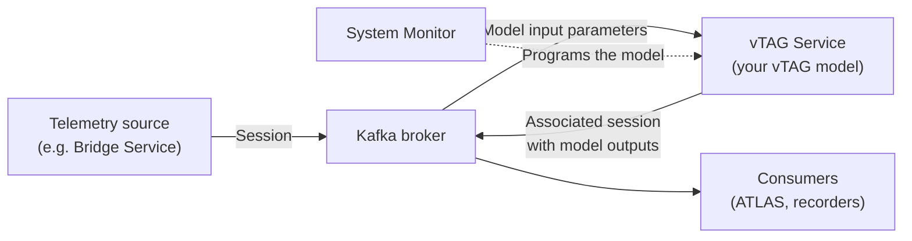

# vTAG Service

vTAG Service runs your vTAG model on telemetry it reads from a Kafka broker, and publishes the model's outputs back to the broker as a new session, all without ADS.

## At a glance

| | |
|---|---|
| **Application** | `MA.DataPlatforms.vTAGService.exe` (Windows console application) |
| **Platform** | Windows, 32-bit process (runs on 64-bit Windows) |
| **Input** | A session streamed to a Kafka broker using the [Open Streaming Architecture](../../stream/open_streaming_architecture/index.md) (Stream API) |
| **Output** | An associated session containing your model's output parameters, written back to the same broker |
| **Model** | A vTAG application (`.pgv`) programmed onto the service's virtual vTAG unit with System Monitor |
| **Configuration file** | `Documents\Motion Applied\vTAG Service\AppConfig.json` |
| **Logs** | The console window, plus daily rolling files in `Documents\Motion Applied\vTAG Service\logs` |
| **Licence** | A Motion Applied licence with the vTAG Server feature (you don't need vTAG Server installed) |

## vTAG Service or vTAG Server?

Both run the same vTAG models that you build from Simulink. They differ in where the input data comes from and where the outputs go.

| | vTAG Service | [vTAG Server](../vtag/index.md) |
|---|---|---|
| **Input data** | A session on a Kafka broker, using the Open Streaming Architecture | A live ADS telemetry stream, or a session replayed in ATLAS |
| **Output data** | An associated session on the broker | vData recorded by the ADS VTS Recorder (`.ssv` files) |
| **Needs ADS** | No | Yes, for live use |

Choose vTAG Service when your telemetry is already on a Kafka broker, for example published by the [Bridge Service](../../../developer-resources/secu4/bridge_service/index.md), or when your model uses parameters that don't come directly from the TAG unit. Anything that writes those parameters to the stream can feed the model.

Choose vTAG Server when you work with ADS and the VTS Recorder, or when you need historical replay inside ATLAS.

!!! warning "Live sessions only"
    vTAG Service processes sessions as they are streamed. It doesn't replace vTAG Server's historical replay features, such as lap-based calculation periods or replaying from the coverage cursor.

## How it works

1. When vTAG Service starts, it connects to the Kafka broker and starts its virtual vTAG unit.
2. You program your vTAG application onto that unit with System Monitor, just as you would with vTAG Server.
3. vTAG Service reads the model's input and output parameters from the programmed application, then subscribes to those inputs on the broker.
4. When a session is streamed to the broker, vTAG Service runs the model at the model's own base rate and writes the outputs to an associated session.
5. If you reprogram the unit while the service is running, vTAG Service picks up the new model's parameters automatically. You don't need to restart it.

## What you must configure

Most setups change only three settings: the broker address, the data source your telemetry is published under, and the folders holding your model's `.pgv`, `.cfg` and `.pul` files. See [Point vTAG Service at your broker and files](getting-started.md#4-point-vtag-service-at-your-broker-and-files).

## Next steps

- [Getting Started](getting-started.md): install, licence, configure and run your first model.
- [Configuration Guide](configuration-guide.md): common tasks, such as changing the output session or batching.
- [Configuration Reference](configuration-reference.md): every `AppConfig.json` setting.
- [Troubleshooting](troubleshooting.md): what to do when the service doesn't start or doesn't produce outputs.
