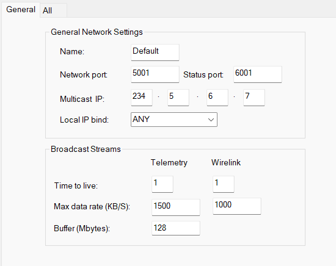
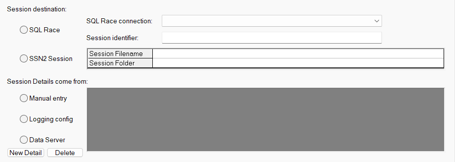
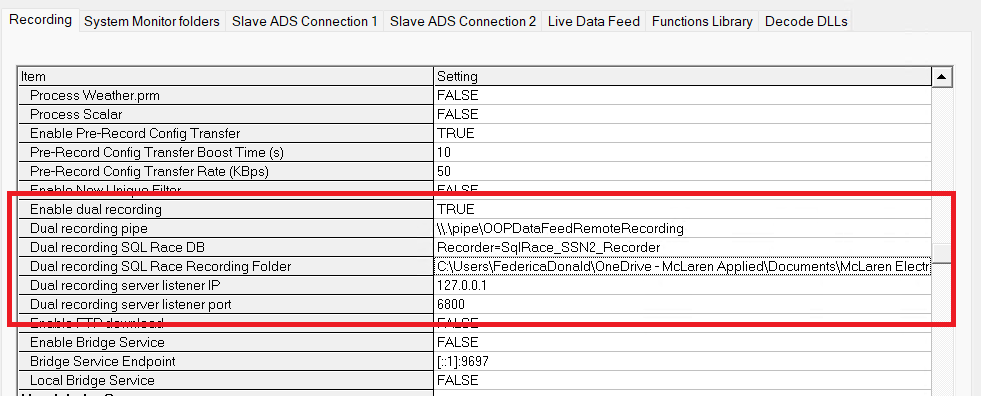
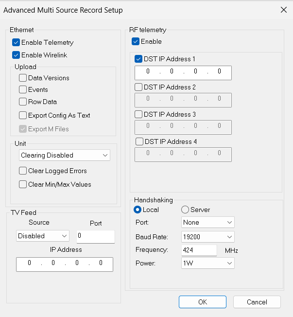
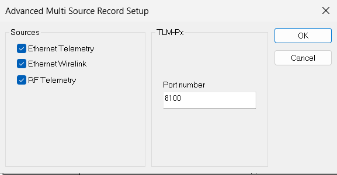

In ADS, a “recorder” is the configured input/output endpoint that defines how data enters ADS (protocol/device/source) and how/where it gets stored/offloaded/distributed. 

To access recorders, click `Setup > Add`

| Source | Description |
|--------|-------------|
| Ethernet Telemetry | Data is continuously uploaded while the car is connected via Ethernet. |
| Ethernet Wirelink | The contents of the data logging memory are uploaded when the car is connected via Ethernet. |
| RF Telemetry | Data is continuously uploaded while the car is transmitting Wide Band Telemetry. |

### General tab

The **General** tab is the first step in setting up ADS on your network.

Configure the following settings:

- Network parameters
- Status port for custom status monitoring services
- *(Optional)* Broadcast Streams for global telemetry and wirelink settings

### All tab

Use the **All** tab to define default session settings (details, export location, and so on) that apply to all future recorders on this ADS instance.

Session identifiers, folders and details can contain wildcards that ADS fills in when it records, such as the date, driver or a parameter value. See [Session identifiers, folders and wildcards](#session-identifiers-folders-and-wildcards).

## Session identifiers, folders and wildcards

Each recorder names its sessions from the **Session identifier**, **Recording folder** and session detail fields on its properties page. These fields accept wildcards, so ADS can name each recording automatically. Instead of typing a fixed session name, you
enter codes such as `%Y%m%d` or `$NDriverInitial1$`. ADS replaces them with the recording date,
session details, or live parameter values from the car.

How wildcards are resolved depends on the session destination you choose:

| Destination | How to select it | Who resolves the wildcards |
|---|---|---|
| **SSN** | **Session destination** = **Session file** | ADS |
| **SSN2** | **Session destination** = **SQL Race**, with an SSN2 (single session) **SQL Race connection** | SQL Race |
| **SQL Race DB** | **Session destination** = **SQL Race**, with a database **SQL Race connection** | SQL Race |

SSN2 and SQL Race DB recordings use the same SQL Race resolver, so they behave the same way.
Where SSN behaves differently, this page says so.

### Where wildcards can be used

| Field | SSN | SSN2 / SQL Race DB |
|---|---|---|
| **Session Filename** | Yes | — |
| **Session Folder** | Yes | — |
| **Session identifier** | — | Yes |
| **Recording folder** | — | Yes. For SSN2 this is where the finished `.ssn2` file goes. For SQL Race DB it holds the RAW data files when RAW data logging is on. |
| **Export Location** | — (exports go to the session folder) | Yes |
| **Session details** (Session Name, Driver, Notes, user-defined details, …) | Yes | Yes |

The defaults already use wildcards. The session filename and the SQL Race session identifier both
default to `%y%m%d%H%M%S`, and the **Session Name** detail defaults to `%r %n` (driver followed by
session number).

### Wildcard reference

#### Date and time

| Code | Replaced by |
|---|---|
| `%Y` | Year, four digits |
| `%y` | Year, two digits on SSN (see the warning below for SSN2 and SQL Race DB) |
| `%m` | Month, `01`–`12` |
| `%d` | Day of the month, `01`–`31` |
| `%H` | Hour (24-hour clock), `00`–`23` |
| `%M` | Minute, `00`–`59` |
| `%S` | Second, `00`–`59` |

The date and time are taken from the time the recording started, not the time the session is
closed.

!!! warning "Use `%Y` rather than `%y` on SSN2 and SQL Race DB"
    SQL Race resolves `%y` to a four-digit year, the same as `%Y`. Fields that SQL Race resolves,
    such as **Recording folder** and **Export Location**, therefore get a four-digit year from `%y`.
    Use `%Y` when recording to SSN2 or SQL Race DB so the result is predictable.

!!! warning "Codes are case-sensitive"
    `%m` is the month and `%M` is the minute. `%c` is the circuit and `%C` is the chassis number.

#### Session details

| Code | Replaced by the session detail |
|---|---|
| `%r` | Driver |
| `%n` | Session Number |
| `%c` | Circuit |
| `%C` | Chassis number |
| `%e` | Engine Description |
| `%a` | Car |
| `%t` | Race/Test |

To use any other session detail, including user-defined details, use
`$SESSIONDETAIL_<detail name>$`. For example, `$SESSIONDETAIL_Note 1$` inserts the value of the
**Note 1** detail.

!!! tip "Write the detail name exactly as it appears"
    On SSN, ADS converts underscores in the detail name to spaces, so `$SESSIONDETAIL_Note_1$` also
    works. SQL Race (SSN2 and SQL Race DB) matches the name exactly, so on those destinations
    `$SESSIONDETAIL_Note_1$` only matches a detail called `Note_1`. For settings shared across destinations,
    use detail names without literal underscores and write them exactly as they appear, spaces included.

#### Data source

| Code | Replaced by |
|---|---|
| `%O` | Data source description (long form) |
| `%o` | Data source description (short form) |

!!! warning "SSN only"
    SQL Race does not recognise `%O` or `%o`. Use them only when recording to SSN.

#### Parameter values

| Syntax | Replaced by |
|---|---|
| `$<parameter>$` | The value of the parameter at the end of the recorded data, formatted with the parameter's own display format |
| `$<parameter>{<format>}$` | The same value, formatted with a printf-style format such as `{%5.2f}` or `{%d}` |

Example: `$NDriverInitial1$$NDriverInitial2$$NDriverInitial3$-%c` could resolve to `ALO-Brazil`.

Things to know about parameter wildcards:

- The parameter must be recorded in the session and must not be RDA-locked. Otherwise ADS has no
  value to insert.
- The value comes from the end of the recorded data. Until the parameter has been recorded there is
  nothing to insert, so the session can start with the wildcard unresolved.
- While a session is recording, ADS and SQL Race re-resolve the identifier and details about every
  3 seconds. They resolve them one final time when the recording stops.

### When a wildcard cannot be resolved

What you see depends on the destination and the field:

| Situation | SSN | SSN2 / SQL Race DB |
|---|---|---|
| `%` code whose session detail is empty | The code is left as typed (for example `%r`) | The code is left as typed |
| `$...$` with no value yet, in the identifier or file name | Left as typed | Left as typed |
| `$...$` with no value, in a session detail | Left as typed | Replaced with an empty string |
| Unrecognised `%` code (for example `%x`) | Replaced by the character after `%` (`%x` → `x`) | Left as typed |

!!! note
    A wildcard left as typed in a session identifier usually means its value was not available when
    the recording stopped. Check that the session detail is filled in, or that the parameter was
    recorded and is not locked.

### Nested wildcards

A session detail can contain wildcards of its own. For example, the **Session Name** detail
defaults to `%r %n`, and the session identifier can include `$SESSIONDETAIL_Session Name$`.

- **SSN:** ADS resolves nested wildcards in up to three passes.
- **SSN2 / SQL Race DB:** SQL Race resolves the string once. `%r`, `%n`, `%c`, `%C`, `%e`, `%a` and
  `%t` inside an inserted value are still resolved, because SQL Race processes them after the
  `$...$` wildcards. Date codes inside an inserted value are not resolved.

### Examples

| Setting | Value | Result |
|---|---|---|
| Session Filename (SSN) | `%y%m%d%H%M%S` | `261029143005` |
| Session identifier | `%Y-%m-%d_%c_%n` | `2026-10-29_Silverstone_12` |
| Recording folder | `D:\Data\%Y\%m\%d` | `D:\Data\2026\10\29` |
| Session Name detail | `%r %n` | `ALO 12` |
| Session identifier | `$NDriverInitial1$$NDriverInitial2$$NDriverInitial3$-%c` | `ALO-Brazil` |

The circuit, driver and session number values above are only illustrations. Real results depend on
your session details and on the data recorded.

## Recorder types

### Dual Recorder

Dual Recorder writes to two different locations by duplicating the primary recorder.

To enable Dual Recorder:

1. Go to **Tools** > **Options** > **Recording** > **General**
2. Set **Dual Recorder** to `true`
3. Set the **Dual Recording SQL Race DB** to Recorder
4. Set the **Dual Recording SQL Race Recording Folder** path to where you want to save the data
5. Click **OK** to save

### DST Multi Source Recorder

A Multi Source Recorder automatically uploads data from available sources (Ethernet Telemetry, Ethernet Wirelink, or RF Telemetry). This ensures sessions use the best available data source at any time. Typically, Ethernet Telemetry operates in the pit, RF Telemetry on track, and Ethernet Wirelink offloads missed data.

Configure these options:

| Option | Description |
|--------|-------------|
| **Car number** | 1-4. Must match the value in System Monitor. |
| **Car** | Select a Car Definition from the drop-down list. |
| **Data source** | **DATA Lab Memory** (chassis parameters), **Burst Memory** (engine parameters), or **Burst and DATALab** (both). |

### TLM‑Px Multi Source Recorder

Before configuring the TLM-Px Recorder in ADS, The Telemetry Controller PC must be configured (VPN Agent Manager, Telemetry Controller Dashboard, and Telemetry Controller Interface). Once the Telemetry Controller is set up, follow these steps to configure the TLM-Px Multi Source Recorder in ADS:

1. Click `Setup > Add` and select TLM‑Px Multi Source Recorder
2. Select the car by unit IP (example: `172.27.92.26`)
3. In **Advanced settings** > **TLM‑Px** tab, set **Port number** to match the Control Telemetry Output UDP port(example: `4001`)
4. Configure other settings as needed 
5. Click **OK** to save

